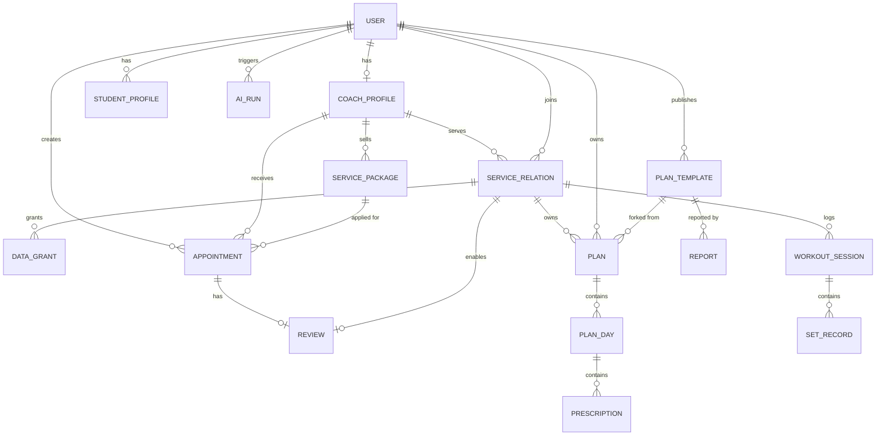
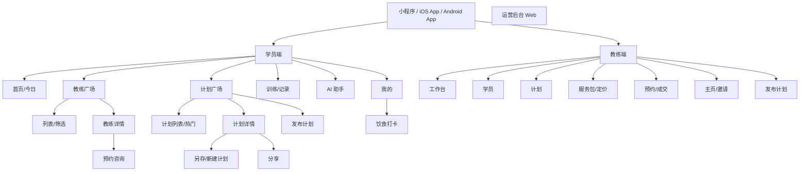

# Nerae 产品需求文档（PRD）

> 项目代号：Nerae（可替换）
> 版本：v1.12 · 2026-11-14
> 状态：产品方向已确认；方案修复与开发规划版，业务实现与上线资格尚未验收
> v1.12（2026-11-14）：§5.5 同步用户确认的训练记录规则；现有 APP_FLOW、OpenAPI、ER、代码及测试尚未全部同步，冲突和后续责任见 `docs/evidence/K01/K01-04/compatibility-matrix.md`。产品目标不代表旧接口或现有 App 已支持。
> v1.11（2026-10-27）：用户选择微信小程序与 App 同步交付；App 首批按 iOS / Android 规划。R05 流程图获得初步正向反馈，细节仍按三端实现和实际验收收敛。实施顺序见 `docs/IMPLEMENTATION_PLAN.md`。
> v1.10（2026-10-23）：修复依据见 `docs/方案修复对照-v1.2.md`；具体任务/日期规则见 `docs/APP_FLOW.md`。
> 变更：
> - v1.8 → v1.9 按 ER/API 审核补齐：独立服务关系发起、双方确认快照、即时撤权与乐观版本；公开模板和私人计划分别版本化；AI 预填确认绑定草稿版本；饮食自评与实际观察分开，证据不足明确返回 `insufficient_data`。本次不改变训练/饮食广场、教练自主定价、免费层和不收款方向。
> - 数据字段与接口实现以 [ER 修订稿](数据模型与ER设计.md) 和 [OpenAPI 1.2.0](../api/openapi.yaml) 为准；本文件旧字段清单只作概览，不视为可直接建库的 DDL。
> - v1.3 → v1.4 按复核结论重写：新增**训练计划广场**（免费学员可浏览、另存新建、分享、看热门）；AI 分层为「教练副驾」与「免费自助」；补齐服务关系、健康数据授权、AI 安全状态机、通信规则；删除未经确认的价格下限和固定工期/预算承诺；修正 58% 的引用口径与资质绝对化表述。
> - 你已确认且本版不变：教练自主定价、学员在教练广场自行选择、线上指导 + 训练记录 + AI、A 阶段平台内不收款；教练端维持原设计。
> - v1.7 → v1.8 新增**异常饮食识别**：AI 预填之外，规则 + 模型标记异常饮食，进入教练「需关注」与运营复核队列（只标记、不诊断）。
> - v1.6 → v1.7 开放**学员发布饮食计划**（打来源标签、分类展示）；新增**饮食打卡**（P0-B）与**AI 发布助手**（预填结构化字段，发布者确认）；确认档位餐单（L2）允许。
> - v1.5 → v1.6 新增**饮食计划**：与训练计划共用广场机制，但只做非医疗原则与档位餐单，不做个性化处方；教练可发布训练/饮食计划到广场。
> - v1.4 → v1.5 **冻结四项取舍**：免费 AI 边界（不给从零个性化处方）、计划广场未登录可浏览、学员分享「自动校验 + 举报驱动抽检」、首期人群「增肌 / 减脂 · 18–28 岁」；同时写入 18 岁年龄门槛。

---

## 0. 一句话

**Nerae 是一个「教练广场 + 训练计划广场 + AI 辅助」的平台**：学员可以先用现成计划开始练，也可以自己建计划、分享计划；想被管的时候，去教练广场按目标、预算、时间选教练，由教练做个性化交付。教练自主定价、自主经营，平台提供获客入口和交付工具，不抽佣、不代收。

**A 阶段边界**：小程序和 App 内均**不收款、不代收、不分账**。经平台核定的联系渠道可用后，学员与教练咨询并由双方确认服务约定；咨询本身不建立关系或健康授权。陌生获客渠道尚未核定时保持关闭。平台收费方式留待验证，本阶段不向任何一方收费。

---

## 1. 背景与判断

### 1.1 市场基线（详见 `docs/市场事实清单.md`、`docs/海外私教AI教练_事实清单.md`）

| 事实 | 数据 | 对我们的含义 |
|---|---|---|
| 线上私教需求存在，但以低价月付为主 | 线上 1v1 常见 199–499 元/月；低价平台有 25 元/月档；闲鱼「体重管理」类服务有月销近万单的样本 | 服务包以月付小包为主，不做大课包 |
| 教练获客依赖内容与转介绍 | 自由教练获客以小红书/转介绍为主，成交周期以月计（媒体样本） | 广场必须带来真实预约，否则教练会流失 |
| 平台抽佣与教练利益冲突 | 乐刻教练课时费分成约 43%–58%（媒体口径） | 不做抽佣，用工具与真实成交换供给 |
| 纯 AI 教练已被大厂免费化 | Keep AI 教练 Kaka 覆盖百万级用户（官方口径），订阅会员存在下滑 | AI 不是收费点，是入口与效率工具 |
| 流量撮合已被本地生活平台占住 | 美团已有「找教练」入口 | 不拼流量广度，拼交付深度与复购 |
| 双边补贴冷启动有失败先例 | 健康猫 2018 年爆雷，涉补贴与刷单 | 不做补贴冲 GMV |
| 海外教练侧以工具订阅为主 | Trainerize、TrueCoach、Everfit 等按月/按客户收费，不抽佣 | 工具价值可收费，但 A 阶段先验证使用 |
| 海外真人教练仍是付费主体 | Future、Caliber、CoPilot 等以真人服务收费；AI 多并入订阅不单卖 | 收费靠真人服务，AI 做提效 |
| AI 生成训练建议存在真实安全缺陷 | 24 项研究 / 2512 人系统综述：**14/24 项研究报告了安全缺陷**；人机头对头比较中 LLM 多数不优于人类（摘要口径） | 不是「58% 的计划都错」；结论是**必须有人审与规则约束**，不能免审直发 |

### 1.2 核心判断

1. **广场要做，但不是「健身版大众点评」。** 价值是让人「选得动」：匹配、真实履约数据、结构化服务说明，而不是信息堆砌。
2. **免费学员必须有可用的东西，否则留不住人。** 计划广场（浏览 / 另存 / 新建 / 分享 / 热门）是免费层的核心，比「只给记录和问答」更有价值，也比「免费直接生成个性化处方」更安全。
3. **教练自主定价，但交付内容必须结构化。** 放开价格的同时必须放开「交付说明」：包含什么、响应多久、是否视频、有无周报。
4. **AI 分层：教练用来自动化，学员用来自助但需确认。** 教练侧 AI 生成草稿、教练确认发布；学员侧 AI 做解读、记录分析、模板内调整建议，不承诺从零生成个性化处方。
5. **先验证一个明确人群，不急着铺城市。** 首期人群已定：**增肌 / 减脂，18–28 岁健身人群**。模板库、教练招募、内容选题与 AI 提示词都围绕这个人群；城市维度只在实际履约需要时展示。
6. **V1 不碰钱。** 不接支付可以省掉大量前置工作，但**不等于免掉资质、备案、数据安全与平台责任**，这些按实际业务另行核定（见 §10）。
7. **「免费工具 → 真人付费」尚未被验证。** 我们不是在复制一个成熟模型，而是在验证它，所以指标必须分开统计，不能混着看。

---

## 2. 用户与场景

### 2.1 角色

| 角色 | 描述 | 核心诉求 | 平台价值 |
|---|---|---|---|
| 自助学员 | 18–28 岁，想增肌或减脂，暂时不请教练 | 有现成计划可跟、能记录、能看到进步 | 计划广场 + 记录 + AI 解读 |
| 付费学员 | 18–28 岁，有明确目标，愿意为「有人管」付费 | 选对教练、练得下去、看到变化 | 教练广场 + 教练交付 + AI 陪伴 |
| 教练（小 B） | 自由教练/工作室教练，有内容账号，带 10–40 个私域学员 | 稳定获客、少做重复劳动、把钱收到 | 广场曝光 + AI 副驾 + 交付工具 |
| 运营（内部） | 审核、投诉、客服、内容 | 供给质量可控、内容安全可控 | 审核后台与 SOP |

> 首期重点人群 18–28 岁；不限制 28 岁以上用户使用，但模板、内容与教练招募按首期人群设计。未满 18 岁不开放（见 §5.5）。

### 2.2 学员 JTBD

- 当我想开始练但不知道怎么排，**我想直接找到一套合适的现成计划照着练**，而不是从零研究。
- 当我练了一段时间，**我想自己调整或组合出一套计划**，并记录每次训练。
- 当我练出一点成果，**我想把我的计划分享给别人**，也想看看别人练什么、什么最热门。
- 当我在几个教练之间犹豫，**我想看到真实交付证据**（评价、响应速度、计划样例），这样我敢约。
- 当我请了教练，**我想每天知道练什么、练得对不对、教练有没有看见我**，这样我能坚持。

### 2.3 教练 JTBD

- 当我有粉丝但转化不动，**我想让感兴趣的人直接看到服务包并预约**。
- 当我带 20 个学员，**我想 30 分钟内处理完当天的计划和反馈**。
- 当学员快到期，**我想系统提醒我该续费、该说什么**。

### 2.4 三条核心循环

**免费自助循环**
```
进入 → 浏览计划广场（官方/教练/学员计划）→ 另存为我的计划或从空白新建
     → 按计划训练并记录 → AI 解读记录与调整建议（用户确认后应用）
     → 自己修改计划 / 分享计划 → 看热门与收藏
```

**学员付费循环**
```
免费使用中 → 广场浏览/被推荐教练 → 看详情与评价 → 预约咨询
          → 平台外成交 → 学员确认服务关系 → 教练交付（计划/点评/周报）
          → 续费或结束
```

**教练循环**
```
入驻审核 → 主页 + 自主定价 + 服务包 → 广场曝光/邀请学员 → 工作台待办
        → AI 草稿 → 教练确认发布 → 点评/周报 → 成交回填 → 续费
```

---

## 3. 产品结构

| 层 | 用户 | 能力 | 商业角色 |
|---|---|---|---|
| 免费层 | 学员 | 训练计划广场（浏览/新建/分享/热门）、训练记录、身体数据、AI 解读与问答 | 获客与留存 |
| 广场层 | 学员 | 教练列表、筛选、详情、评价、预约 | 选择与预约入口 |
| 交付层 | 学员 + 教练 | 计划、打卡、点评、周报、消息 | 留存与复购 |
| 工具层 | 教练 | AI 副驾、学员管理、定价、成交回填、数据看板 | 供给杠杆 |
| 后台 | 运营 | 教练审核、内容审核、预约与投诉、AI 监控 | 风控与运营 |

**设计原则**

1. AI 不替代教练，只降低教练「关注学员」的成本；学员侧 AI 给建议，改计划要用户确认。
2. 广场排序**不做竞价**，只做匹配 + 履约 + 评价。
3. 数据留在平台，教练可导出自己的学员名单（不含学员敏感健康数据）。
4. 教练端常规操作要快：打开、标记、保存这类动作不超过 30 秒；**专业判断不设秒数上限**。
5. 合规优先：不承诺疗效、不做医疗建议、不做长周期预付。

### 3.1 三条硬约束（不可裁剪）

任何功能破坏这三条就不发。

| # | 约束 | 为什么 | 落地位置 | 验收方式 |
|---|---|---|---|---|
| 1 | **交付必须有据可查**：服务关系双方确认，训练与反馈有记录 | 平台不收款，能证明价值的只有真实交付记录 | §5.8、§7 service_relation、§9 | 关系状态可审计；学员确认 + 教练确认双记录 |
| 2 | **常规操作 30 秒，专业判断不设上限** | 太快会诱导草率审核；太慢教练会回微信 | §5.6 工作台 | 常规待办 P50 ≤30s；审核类任务只测完成率与返工率 |
| 3 | **AI 分层管控**：教练侧必须人工确认；学员侧建议需用户确认 + 规则校验；安全阻断不得降级绕过 | AI 生成训练建议已被证明存在安全缺陷 | §5.4、§6 | 安全阻断用例不得回退到模板或问答绕过 |

---

### 3.2 已确认决策（冻结）

| # | 决策 | 说明 |
|---|---|---|
| 1 | 教练自主定价 | 平台不设强制价格下限，只做结构化交付说明 |
| 2 | 学员在教练广场自行选择 | 平台不做人工指派、不做竞价排名 |
| 3 | 线上指导 + 训练记录 + AI | 不涉及医疗、康复、体态矫正 |
| 4 | A 阶段平台内不收款 | 不代收、不分账；交易在平台外完成 |
| 5 | 训练计划广场 | 免费学员可浏览、另存新建、分享、看热门 |
| 6 | 免费 AI 边界 | 只做解读、记录分析、动作问答、模板内建议；不从零生成个性化处方 |
| 7 | 计划广场未登录可浏览 | 另存、收藏、记录训练需登录 |
| 8 | 学员分享审核强度 | 发布前自动校验；人工抽检 + 举报驱动；不做全量人工 |
| 9 | 首期人群 | 增肌 / 减脂，18–28 岁健身人群 |
| 10 | 饮食计划 | 与训练计划并列；档位餐单（L2）允许；不做个性化处方与疾病饮食 |
| 11 | 学员可发布饮食计划 | 与教练发布分类展示；教练内容打「教练发布」标签；学员内容标「非专业建议」 |
| 12 | 饮食打卡 | P0-B：按计划「吃了几天」自评打卡 |
| 13 | AI 发布助手 | 发布训练/饮食计划时由 AI 预填结构化字段，发布者确认后提交 |
| 14 | 异常饮食识别 | 规则 + 模型标记异常饮食，推给教练与运营复核；只提示不诊断 |
| 15 | 微信小程序与 App 同步交付 | iOS / Android 与小程序纳入同一批功能和验收；各平台审核/上架时间分别由真实结果决定 |

---

## 4. 版本范围

### 4.1 功能清单

**P0-A 核心闭环（决定能不能上线）**

P0-A 与 P0-B 均覆盖微信小程序、iOS App 和 Android App；H5 是辅助开发与检查入口。

| 模块 | 功能 |
|---|---|
| 账号与关系 | 各端登录、双角色、学员档案、服务关系确认与数据授权；跨端账号绑定方案先核定 |
| 教练广场 | 列表、基础筛选、排序、教练详情、评价展示、预约 |
| 自主定价 | 结构化服务包、教练定价、上下架、交付承诺 |
| 交付 | 计划发布、点评 |
| 教练工作台 | 今日待办、学员列表、学员详情、AI 草稿 |
| 记录 | 计划训练/自由训练、组记录、上次重量、身体数据 |
| 预约与回填 | 咨询单、站内消息、状态流转、成交自报 |
| 运营后台 | 教练审核、内容审核、预约与投诉处理、AI 监控 |

**P0-B 免费层价值（决定留不留得住人）**

| 模块 | 功能 |
|---|---|
| 训练计划广场 | 列表（未登录可浏览）、筛选（默认增肌/减脂）、详情、热门榜、收藏 |
| 饮食计划 | 官方/教练/学员发布（带来源标签）、另存、查看、分享；不做个性化处方 |
| 饮食打卡 | 按计划每日自评打卡、连续天数、7 日依从率 |
| 发布助手 | 训练/饮食计划发布时 AI 预填字段（发布者确认） |
| 异常识别 | 热量/蛋白/餐次/过敏原/极端方法异常标记，教练待办 + 运营复核队列 |
| 我的计划 | 从模板另存、从空白新建、编辑、删除、版本 |
| 分享 | 生成分享卡/链接、公开或仅链接可见、改编标注、举报 |
| AI 自助 | 计划解读、记录分析、动作问答、模板内调整建议（需确认） |

**P1**

- AI 导购（4 问推荐教练）、教练成交看板、学员成长海报
- 周报自动化、打卡表单、邀请海报
- 打卡小组、周挑战
- AI 周期化建议（仍需用户确认）、饮食原则问答

**P2**

- 1v1 视频通话、动作视频反馈、动作识别纠错
- 多城市、多语言、直播

### 4.2 明确不做（V1）

- 平台内支付、抽佣、分账、退款、储值（B 阶段再议）
- 竞价排名、广告位
- 长周期预付（>3 个月）、大课包
- 医疗/康复/体态矫正类服务
- **自由发帖社区、图片/视频流**（计划广场只做结构化训练计划，不做泛内容社区）
- 直播带练

---

## 5. 功能需求

### 5.1 M1 教练广场

**目标**：让学员在 3 分钟内选出一个可预约的教练；让教练看到「展示 → 预约 → 成交」的真实转化。

#### 5.1.1 列表页

- 顶部目标选择器：增肌 / 减脂（首期默认）/ 塑形 / 体能 / 新手入门
- 筛选：服务方式（纯线上 / 线上+线下）、价格带（<299 / 299–499 / 499–799 / >799）、性别、可约时段；城市仅对线下服务展示
- 卡片字段：头像、姓名、认证标识、擅长标签（≤3）、服务方式、起售价、评分与评价数、响应时长、最近可约
- 排序：推荐（匹配 + 履约 + 评价）、好评优先、价格从低到高、新教练
- 底部：AI 导购入口（P1）——「不知道选谁？回答 4 个问题，我帮你挑 3 个」

**排序规则（可解释、不做竞价）**

| 因子 | 权重 | 说明 |
|---|---|---|
| 匹配度 | 40% | 目标/水平/时间/预算与学员档案的匹配 |
| 履约分 | 25% | 24h 响应率、点评率、按时交付率、成交反馈完整度（仅内部权重，不对外宣称真实性） |
| 评价 | 20% | 加权评分（按评价数平滑；样本不足不展示精确分数） |
| 活跃度 | 10% | 近 30 天接单与更新 |
| 新星扶持 | 5% | 入驻 <60 天且完成 ≥3 次有效交付的教练 |

> 反馈完整度只用于内部排序参考，不展示为「数据可信」标识；没有样本时按同人群均值处理，并在后台注明。

**验收标准**
- [ ] 首屏 ≤1.5s 出内容（骨架屏 + 分页）
- [ ] 筛选为空时给「放宽条件」引导
- [ ] 排序权重后台可配，变更留审计日志
- [ ] 曝光、点击、停留、预约转化全部埋点

#### 5.1.2 教练详情页

1. 头部：头像、姓名、认证、教学年限、服务方式、响应时长、评分
2. 自我介绍（结构化：风格 / 擅长人群 / 不接什么学员）
3. 资质与案例（需审核）
4. 服务包（≤3 档，教练自主定价）：名称、价格、周期、包含内容、响应 SLA、是否含视频、可约时段
5. 评价（维度均分 + 最新 10 条 + 全部）
6. 常见问题（教练自定义 3 条）
7. 底部固定 CTA：选套餐 → 预约咨询
8. 风险提示：不承诺效果、非医疗建议、交易与退款由教练与学员自行处理

**验收标准**
- [ ] 未登录可浏览，预约前登录
- [ ] 服务包用统一模板渲染，不接受纯文本自由发挥
- [ ] 禁止「包瘦 X 斤」「治疗」「康复」「保证」等词，命中即拦截提示
- [ ] 详情 → 预约转化率埋点

### 5.2 M2 教练自主定价

#### 5.2.1 定价模型

教练选模板，填价格与交付承诺：

| 套餐类型 | 周期 | 必填交付项 |
|---|---|---|
| 体验包 | 7 天 | 1 次计划 + 2 次点评 + 1 次答疑 |
| 月度标准包 | 30 天 | 计划 ≥2 次更新、每周点评、48h 内响应 |
| 月度深度包 | 30 天 | 每周 1 次视频/语音、24h 响应、周报 |
| 按次指导 | 单次 30–45 min | 1 次指导 + 课后计划调整 |

规则：
- **价格由教练自行设定**，平台只给参考区间，不设强制下限，不因低价阻断上架。
- 价格修改 T+1 生效；已成交服务按签约快照执行，不受新价影响。
- 不允许「先涨价再打折」的虚假原价。
- 不提供季度/年度包，规避预付式消费风险。
- 明显异常低价（如低于同人群 P5）只提示运营关注并提醒教练补充交付说明，**不阻断**。

#### 5.2.2 教练主页与资质

- 必填：真实姓名、身份证（仅后台可见）、手机号、教学年限、擅长领域、服务方式
- 选填：证书（上传，运营抽检）、案例、自我介绍
- 认证标识：实名 + 资质审核通过后显示「已认证」
- 教练可随时下架服务包；进行中的服务按快照履约

**验收标准**
- [ ] 服务包必须选模板并填满必填交付项才能上架
- [ ] 改价、下架、资质变更留操作日志
- [ ] 教练可导出自己的学员名单（不含学员健康数据）

### 5.3 M3 计划广场（训练 + 饮食，免费层核心）

**目标**：让不想请教练的学员也能马上开练、吃得明白；让教练和学员的优质计划被复用；用结构化内容替代自由发帖，把审核成本压到可控。

两类内容共用浏览、另存、分享、热门机制，但**饮食内容的安全边界更严**（见 §5.3.8）。

#### 5.3.1 内容来源与标识

| 来源 | 发布方 | 审核 | 默认可见性 | 标识 |
|---|---|---|---|---|
| 官方模板 | 平台/签约教练编写 | 上线前专业审核 | 公开 | 「官方模板」 |
| 教练计划 | 已认证教练 | 自动校验 + 抽检 | 教练可选公开 | 「教练 · 已认证」 |
| 学员分享 | 学员 | 自动校验 + 举报后人工 | 用户选公开/仅链接 | 「学员分享 · 非专业建议」 |

**内容类型**

| 类型 | 可发布方 | 说明 |
|---|---|---|
| 训练计划 | 官方 / 教练 / 学员 | 学员可分享自建训练计划 |
| 饮食计划 | 官方 / 教练 / 学员 | 学员可发布，需过校验并标「非专业建议」；默认不进新手推荐 |

**来源标签与分类展示**

- 教练发布：列表、详情、分享页统一显示「教练发布 · 已认证」标签
- 学员发布：显示「学员分享 · 非专业建议」标签
- 官方内容：显示「官方模板」
- 列表支持按来源筛选（全部 / 官方 / 教练发布 / 学员分享）；标签不可隐藏或冒用

**关键规则**：三类来源在列表与详情中必须有可辨识标识；「热门」排序中官方与教练内容权重高于学员分享，避免 UGC 刷榜。

#### 5.3.2 列表与筛选

- 类型 Tab：训练计划 / 饮食计划（默认训练）
- 训练筛选：目标（默认增肌/减脂，可选塑形/体能）、器械、每周天数、周期（4/8/12 周）、难度、来源
- 饮食筛选：目标（增肌/减脂）、热量档位、餐数（3 餐 / 3+1 / 3+2）、饮食类型（普通/素食）、排除过敏原
- 来源筛选：全部 / 官方 / 教练发布 / 学员分享
- 卡片字段：标题、来源标签、目标、周期或餐数、器械或热量档位、难度、使用人数、收藏数、评分（有评价时）
- 排序：**热门**（默认）、最新、最多使用、评分优先
- 新手默认只展示官方 + 教练计划，学员分享需手动切换才可见
- **未登录可浏览列表与详情**；另存、收藏、记录训练时登录并回跳

#### 5.3.3 计划详情

**训练计划**

- 概览：目标、周期、频率、器械、适用人群、**不适用提示**（如「有腰伤请先咨询专业人士」）
- 周视图：每天的训练主题与动作清单
- 动作项：动作名、组数×次数、休息、要点、替代动作
- 主操作：「开始这次训练」，必要时自动另存并启用安排；收藏、分享与单独另存在次级菜单。登录/18+声明后回跳原模板与所选日，双击和超时重试不产生重复副本（APP_FLOW F01）。

**饮食计划**

- 概览：目标、热量档位（kcal 区间）、蛋白档位（g/kg 区间）、餐数、饮食类型、适用人群
- 餐次结构：早餐 / 午餐 / 晚餐 / 加餐，每餐列出食物、份量（克或常用份）、替换选项
- 必填标注：**过敏原**（记录常见过敏原、信息来源和未知状态；不限固定八项，不把食品包装标准直接当成平台餐单的完整适用结论）、**不适用提示**（疾病/孕产/未成年请咨询医生或注册营养师）
- 使用方式：「另存为我的饮食计划」「收藏」「分享」；不做「一键开吃」打卡（P1）
- 来源与改编链：显示原作者与「改编自 X」；举报入口

#### 5.3.4 我的计划（新建 / 另存 / 编辑）

- **另存为我的计划**：复制一份到个人账户，与原计划脱钩，可自由编辑（饮食计划另存后按日查看，可改份量）
- **从空白新建**：从动作库选动作、设组次、排到周视图
- **AI 辅助调整**（可选）：基于训练记录给「建议调整」，用户确认后才写入，且必须过规则校验
- 计划版本：每次保存生成版本号，可回滚；已有训练记录不被回滚覆盖

#### 5.3.5 分享

- 学员可发布训练与饮食计划（饮食需通过校验）；发布后按来源打标签，不可自行隐藏
- 生成分享卡/小程序链接，可选「公开到广场」或「仅链接可见」
- 分享页必须包含：来源标识、适用/不适用提示、举报入口
- 改编后分享标注「改编自原计划」，保留原作者署名
- 用户下架分享后，他人已另存的副本不回收（页面说明）
- 侵权投诉通道，72h 内处理

#### 5.3.6 热门机制

- 计分：近 7 天使用人数 × 权重 + 收藏 + 完成率 + 评分；使用与完成需去重到有效训练会话；**饮食计划用查看与另存替代完成率**
- 防刷：同一账号重复使用不计；异常短时间大量使用进人工抽检
- 冷启动：新计划给固定曝光位，按完成率决定是否继续推荐
- 争议内容、举报未结案的降权

#### 5.3.7 安全与审核

- 发布前 **100% 自动校验**：动作必须在动作库内；组数/次数/频率在合理区间；文本过内容安全与风险词
- 人工抽检：按发布量 10–20%（首期），抽检不合格计入作者违规；**不做全量人工**
- 命中禁忌（如给新手排高风险动作、疑似损伤建议）→ 阻断发布并提示
- 被举报 24h 内先下架待审，结案后恢复或保持下架；抽检与举报记录留档
- 累计违规封禁分享权限
- 禁止：效果承诺、诊断/治疗、付费导流、外部联系方式
- 饮食内容额外校验：份量/能量字段一致性、信息来源与未知项、过敏原字段完整性，以及经过专业审核、明确适用人群的风险规则。固定热量/蛋白阈值未核定前不启用，不能用统一数值证明安全。

**验收标准**
- [ ] 三类来源标识在列表与详情都可见
- [ ] 学员分享默认不进新手推荐位
- [ ] 另存副本与原计划脱钩，原计划删除不影响副本
- [ ] 未登录可浏览；触发写操作时登录并回跳原页面
- [ ] 举报到下架的链路可走通，处理时限可查
- [ ] 分享页含免责与举报入口
- [ ] 热门榜可复算（同一周期数据重跑结果一致）

#### 5.3.8 饮食计划专项设计（V1 边界）

**为什么单独设边界**：饮食建议离医疗最近，过敏和疾病是硬风险；平台没有临床营养资质审核能力，因此 V1 只做「非医疗、非个性化」的饮食内容。

**三级内容，只做前两级**

| 级别 | 内容 | V1 | 说明 |
|---|---|---|---|
| L1 饮食原则 | 增肌/减脂怎么吃、外食怎么选、蛋白质来源 | ✅ 官方/教练 | 只讲原则，不给个人数值 |
| L2 档位餐单 | 按体重档位给热量/蛋白区间 + 三餐示例 + 替换 | ✅ 官方/教练/学员 | 用户自己选档位，系统不为个人开处方；学员发布标「非专业建议」 |
| L3 个性化方案 | 结合疾病、过敏、孕产、用药的个体化饮食 | ❌ | 服务关系内由教练一对一沟通，且需转介专业人士；不进广场 |

**结构化字段（发布必填）**

- 目标（增肌/减脂）、热量档位（kcal 区间）、蛋白档位（g/kg 区间）、餐数（3 / 3+1 / 3+2）、饮食类型（普通 / 素食）
- 每餐：食物 + 份量（克或常用份）+ 替换选项；过敏原（八大类）必填；不适用人群提示必填

**禁止清单（发布阻断）**

- 疾病饮食：糖尿病、肾病、高血压、痛风、术后、孕产、儿童青少年、进食障碍
- 极端方法：断食、长期极低热量（具体数值阈值待专业审核，非通用安全界限）、生酮减重、脱水减重、清肠、代餐替代正餐
- 功效承诺与对比图：「7 天瘦 10 斤」「before/after 保证」
- 售卖食品/补剂、外部导流、付费内容

**安全与合规**

- 所有饮食计划页固定展示「非医疗建议；有基础疾病、孕产或饮食障碍请咨询医生或注册营养师」
- 用户可自填过敏原，命中计划过敏原时强提示，但仍以本人核对为准
- 举报与抽检同训练计划：自动校验 100%、人工抽检 10–20%、举报 24h 下架
- 学员发布饮食计划：与教练同一套校验与禁止清单；**首次发布需人工审核通过后公开**，之后自动校验 + 抽检；默认不进新手推荐
- 不做「健康评估问卷 → 自动生成饮食方案」，避免落入诊疗边界

**验收标准**
- [ ] 缺过敏原或不适用提示无法发布
- [ ] 命中极低热量/极端方法词直接阻断
- [ ] 疾病相关词命中后提示转介，不允许发布
- [ ] 分享页保留免责声明与举报入口

#### 5.3.9 发布助手（AI 预填结构化字段）

**问题**：训练/饮食计划必填字段多（动作、组次、餐次、份量、热量档位、过敏原），纯手填太费劲，教练和学员都会放弃发布。

**做法**：发布页提供「用 AI 帮我填」

1. 发布者用自然语言描述（如「增肌期一般早餐两个蛋 + 燕麦，中午鸡胸米饭…」），或从已有计划导入
2. AI 解析出结构化草稿：餐次、食物、份量、热量/蛋白估算区间、过敏原候选、不适用提示
3. 字段级标注「AI 估算」，发布者逐项确认/修改
4. 提交走与手填相同的校验：热量下限、蛋白上限、疾病词、极端方法词、过敏原完整性
5. **AI 只填草稿，不直接发布**；页面注明「AI 辅助整理，发布者负责」

**限制**：每人每日 10 次；图片识别 P1；输出不构成营养或训练建议。

**验收标准**
- [ ] 预填后必填项完整率 ≥90%
- [ ] 发布耗时相比纯手填明显下降（试点测量）
- [ ] 提交绑定服务端草稿 ID、当前版本、内容哈希和已确认估算字段集合；内容改变后旧确认失效；未确认不能提交
- [ ] 误填导致举报的，可回溯到 AI 运行、草稿版本、发布者确认和最终发布版本；确认动作不等于专业审查或准确性保证

#### 5.3.10 异常饮食识别（AI 辅助，只标记不诊断）

**目的**：让教练在每天处理学员时，能一眼筛出「这份饮食可能有问题」的学员，而不是逐条翻打卡；运营也能批量复核发布内容。

**触发时机**
- 学员发布或另存饮食计划时
- 学员每日饮食打卡时
- 教练查看学员详情时（聚合近 7 天）

**识别维度（规则优先，模型补充）**

| 维度 | 示例 | 输出 |
|---|---|---|
| 计划内容风险 | 作者声明的餐单/份量可能不适用，命中经专业审核的版本化规则 | `potential_plan_risk`；不是实际摄入事实 |
| 能量/蛋白观察 | 用户自愿提供且已确认的实食/份量，来源与适用规则足够 | `observed_concern`；注明来自自述或估算，不诊断 |
| 结构 | 餐次自评为未按计划/部分执行，或明确描述饮食问题 | 只提示观察到的自评事实，不把未打卡等同缺餐 |
| 过敏原 | 有权读取的个人过敏原与已确认食物来源明确冲突 | 高优先级复核；信息未知时不宣称安全或必然冲突 |
| 极端方法 | 明确建议脱水、催吐等危险行为，或其他需专业复核的内容 | 按适用政策阻断/转人工；不能仅因否定/引用疾病词一概判断 |
| 信息不足 | 只有是否按计划的勾选、没有真实食物/份量/过敏资料，或 AI 提取尚未确认 | `insufficient_data`，不得补造摄入数值或风险结论 |

**输出与去向**
- 处理等级：`提示` / `需复核` / `阻断`；另外记录证据状态（计划风险 / 有观察的关注项 / 信息不足），附证据来源、内容版本、确认状态与规则版本。证据不足不能伪装成风险阴性或确定异常。
- 教练工作台「需关注」卡片：可查看明细、发消息、标记已处理
- 运营复核队列：批量查看、下架、封禁、留痕
- **不做**：自动诊断进食障碍、自动给学员发警告、公开标注「异常用户」

**措辞边界**
- 对教练：只描述证据实际支持的内容，例如「近 3 天用户自述未按餐单执行」；只有可核对的食物、份量、时间范围与授权齐备，才可展示对应估算，并注明来源和不确定性
- 对学员：不展示「异常」标签；只有教练主动沟通或系统安全提示（如过敏原冲突）
- 所有提示可申诉/误报反馈，用于调阈值

**验收标准**
- [ ] 已获授权、来源明确且已确认的过敏原冲突进入高优先级复核；个人资料或食物信息缺失时明确“信息不足”，不得宣称已排除过敏风险
- [ ] 命中结果带原因与规则版本，可追溯
- [ ] 教练可一键标记「已关注/误报」，误报进入阈值复盘
- [ ] 学员端不出现评判性「异常」标签
- [ ] 复核动作全部留审计

### 5.4 M4 AI 教练（分层）

**通用边界**：不诊断、不处方、不承诺效果；涉疼痛/伤病/疾病/用药 → 停止建议并提示就医。

#### 5.4.1 教练副驾（教练使用）

| 能力 | 输出 | 发布方式 |
|---|---|---|
| 计划生成 | 4 周计划草稿 | 教练审阅 diff → 采纳/编辑 → 发布 |
| 计划调整 | 调整建议 + diff | 同上 |
| 点评/督促/续费话术 | 文案草稿 | 教练一键发送 |
| 周报 | 数据 + 文本草稿 | 教练确认后发送 |

- 教练侧 AI 输出**不得自动发布**给学员
- 所有生成记录 `ai_run`，含模型、版本、成本、安全标记

#### 5.4.2 免费自助（学员使用）

| 能力 | 说明 | 是否改计划 |
|---|---|---|
| 计划解读 | 解释某个模板为什么这样排、动作要点 | 不改 |
| 记录分析 | 完成率、容量趋势、疲劳提示 | 不改 |
| 动作问答 | 动作要点、器械替代、训练安排原则 | 不改 |
| 模板内调整建议 | 基于记录给出减量/换动作建议 | **需用户确认后应用，且过规则校验** |
| 饮食模板解读 | 解释餐单结构与替换逻辑 | 不改 |
| 食物替换建议 | 基于模板给等价替换（热量/蛋白接近） | **需用户确认，且过敏原校验** |

**明确不做**：免费层不提供「从零生成个性化训练处方」；不承诺替代教练；不提供疾病/康复类建议；不提供个性化热量处方与疾病/孕产/未成年饮食建议（转介医生或注册营养师）。

> 该边界已于 2026-10-22 确认：免费层保留可用度依靠计划广场与解读/分析，而不是免费处方。

#### 5.4.3 额度

- 免费：每月 1 次计划解读、每周 1 次记录分析、每日 10 条问答、每月 5 次模板内调整建议
- 额度与成本按实际 token 用量核算，见 §6.6

**验收标准**
- [ ] 教练侧任何 AI 内容未确认不能到达学员
- [ ] 免费层调整建议必须用户确认才写入计划
- [ ] 高风险输入中断并给就医提示
- [ ] 输出带「AI 生成」标识（显性 + 元数据）

### 5.5 M5 训练记录

- **范围与模式**：年满 18 岁后可记录；首版聚焦力量、自重和辅助动作，重量单位为 kg。首次默认「训练后记录」，之后记住用户上次使用的模式并在同账号间同步；可切换「每组完成后记录」。两种方式共享同一条记录、动作段、组和输入，不创建另一份训练。
- **来源与计划**：从本人创建或教练在 Nerae 创建并发送的计划带入，也可从动作库自由选择、搜索、批量添加或创建自定义动作。计划目标与实际记录分开；默认先取计划值，用户可在设置中改变来源或本次切换。本人明确选择按计划应用时使用计划值；确切的 45 kg × 8 次、3 组可直接形成 3 组记录，8–12 次范围则保留目标并标明实际次数未填，不以范围计算累计。
- **动作库与动作段**：本人自定义动作仅本人可在库中查找和使用，名称不能与标准库或本人已有自定义动作重复；历史记录保留当时的名称，改名前后仍关联同一动作历史。标准库后来出现同名时保留双方数据，建议可编辑的新名称并由本人确认。一次训练中允许同一动作出现多段、与其他动作交替；动作库去重不合并本次不同动作段。
- **组的输入与完成**：每组一张卡，支持复制、数字键盘和半屏刻度，重量刻度默认 1 kg，可在设置中更改并在本次临时切换。复制产生可编辑的下一组；训练后可为选中的同一动作段的多组批量填写，未选字段保持原值。逐组模式可点「记下」，但整次点击「完成」时列表中保留的组都各保存一次，包括未单独记下的预填、复制、缺项和空白组；已移除的组不计。缺失值不当作 0、不臆造次数。
- **历史值**：默认可带入上次该动作最后一组重量，并可选择其他历史组；首次沿用时由用户选择应用当前组或该动作全部组并记住，可在设置或本次切换。是否同时带入次数由用户首次选择并可在设置更改。同一动作的历史可跨动作段汇集供选择，不合并原记录；本次与上次有不同参考值时由用户选择。
- **身体重量和双侧**：自重可记录体重及额外负重并显示合计；辅助动作可记录体重减助力，也可直接填写记录重量。本次体重变更联动本次自重组；是否调整直接填写的记录重量、是否写入身体数据曲线分别由本人选择。双哑铃可填单只重量计算两只合计；单侧动作同一组记录左右，默认相同但可分别修改，一侧未做只计另一侧。
- **完成与回看**：完成页显示动作导航、动作数和组数，先展示各组明细，再按动作显示可计算的累计负重及 kg；缺项组说明未计入，统计口径不等同实际测得的受力。保留逐组基础数据供后续周期报告使用；报告的发布方式和未确认口径不在此预先决定。
- **修改、移除与恢复**：组可通过已选择的左滑嵌入滑轨移除，底部提供撤销，记录存在期间可从对应动作「已移除」恢复原内容与位置；整段动作也可移除并恢复，不修改计划。移除某动作最后一组保留该动作的 0 组及恢复入口；移除整次最后一组使记录回到未完成草稿。整条记录删除须二次确认，不设整条记录回收站。
- **草稿与跨端**：草稿自动保存、可跨设备继续；已登录时离线完成须先本机保存成功并标明「待同步」，联网后自动重试，服务端确认后才标为已同步。同一组的并发冲突保留双方供用户选择；另一端已删除整条记录时，本机未同步内容可另存新记录或放弃，不能自动恢复原记录。切换账号隔离数据和待发内容。
- **隐私与日期**：教练须有有效关系及训练记录授权，且整次训练完成并同步后才能查看；仅有训练记录授权时可见计算后的记录重量，隐藏体重及负重/助力拆分，另获身体数据授权后才显示拆分。撤权即时阻止后续服务端访问。训练日期默认当天，可补记过去，拒绝未来/无效日期，录入时间另存，不伪造训练开始或组完成时刻。
- **不做**：训练播放器、训练计时、组间倒计时和后台训练计时；跑步距离及平板支撑时长不纳入首版记录范围。首个可安装测试版须有真实登录及跨设备同步；不能用仅本机草稿或网页代替。

**验收标准**
- [ ] 两模式切换、批量、复制和「完成」对同一份数据生效；列表保留的空组、缺项组各计一次，移除组不计，不要求每组先点「记下」。
- [ ] 计划 45 kg × 8–12 次、3 组按计划应用时保存目标范围与 3 个实际次数未填的组，不虚构次数或累计；原计划不被本次编辑修改。
- [ ] 一动作 12 kg × 12、14 kg × 10 及一组缺次数，逐组明细后显示已计算 284 kg、1 组未计入；双哑铃每只 12 kg × 10 次为 240 kg。
- [ ] 草稿重启与跨设备恢复、离线完成、同步失败重试、两端并发冲突及远端删除后另存都有真实服务和适用设备证据；切号不串数据。
- [ ] 恢复已移除组/动作保留内容与顺序；最后一组移除后转草稿，统计更新。未完成或已撤权训练对教练不可见，身体数据按独立授权控制。
- [ ] 不存在训练计时界面或后台计时；补记按训练日期归档，不伪造完成时间。未满 18 岁不能记录，正式业务工程验证记录与身体数据 CSV 导出。

### 5.6 M6 教练工作台

**今日待办（规则引擎 + LLM 摘要）**

| 待办类型 | 触发规则 | 一键动作 |
|---|---|---|
| 未训练 | 连续 2 天计划日未完成 | 发督促话术（AI 草稿） |
| 需点评 | 学员提交训练 >12h 未点评 | 打开点评页（AI 草稿） |
| 建议加重 | 全部组完成且 RPE ≤6 | 调整下周计划 |
| 停滞预警 | 连续 2 周无进步 | 生成调整建议 |
| 到期续费 | 服务期到期前 7 天 | 续费话术（AI 草稿） |
| 新学员 | 24h 内未建计划 | 生成计划草稿 |
| 饮食异常 | 近 7 天命中「需复核」规则 | 查看明细 / 发消息 / 标记已处理 |

**学员详情页**：档案、当前计划、最近 7 天记录、打卡历史、身体数据趋势、剩余服务期、备注

**验收标准**
- [ ] 工作台首屏 3 秒内加载
- [ ] 常规待办（打开/标记/保存）P50 ≤30 秒
- [ ] 审核类任务单独统计完成率与返工率，不设秒数要求
- [ ] 教练可关闭某类提醒

### 5.7 M7 计划与交付

- 计划编辑器：周视图、拖拽、动作库、组次、RPE、备注
- AI 生成 → 教练审阅（diff）→ 采纳/编辑 → 发布
- 可加「今日加练」「休息日」
- 点评：文字 + 快捷标签 + 语音（P1）
- 周报：自动汇总完成率、训练量、体重变化、下周建议，教练确认后发送
- 打卡：学员提交照片/文字，教练回复

**验收标准**
- [ ] 发布后学员端 5 秒内可见
- [ ] 计划版本可回滚并留痕
- [ ] 周报必须教练确认才发送

### 5.8 M8 预约与服务关系（A 方案核心）

平台不收款，负责把「有意向」变成「可跟进、可确认、可交付」的关系。

#### 5.8.1 预约/咨询单

- 当前教练/套餐、本人已有目标/水平/可训练时间自动预填；只核对差异与必要缺项，预算/备注可省略，不重复收集档案。
- 状态：待联系 → 已联系 → 已确认 → 已完成 / 已关闭
- 教练 24h 内响应（超时提醒，计入履约分）
- 沟通走站内消息；客服消息仅在用户主动发起后按规定窗口发送（见 §5.8.4）

#### 5.8.2 成交自报（不是成交验证）

- 教练可标记：已成交 / 未成交 / 仍沟通 / 失联
- 金额区间选填，**标注为「教练自报」，不展示为已验证 GMV**
- 7 天后未回填提示一次，之后标「未回填」并计入反馈完整度；**不强制认定失败**，后续可补录并留痕
- 学员侧可独立确认「是否已开始服务」

#### 5.8.3 服务关系（交付开关）

| 字段 | 说明 |
|---|---|
| 关系状态 | 待学员确认 → 生效 → 已结束 / 已解除 |
| 双方确认 | 学员确认 + 教练确认，缺一不生效 |
| 套餐快照 | 服务包内容与价格快照，后续改价不影响 |
| 服务期 | 开始/结束时间、续费次数 |
| 数据授权 | 学员选择教练可见的数据范围（见 §5.8.5） |

- 咨询、成交自报、服务关系是**三个独立事实**，不互相替代
- 教练扫码邀请只记录来源，不自动建立服务关系、不自动授权健康数据

#### 5.8.4 通信规则

- 站内消息：咨询会话与服务关系会话独立隔离；有效关系无需咨询单即可双向文字交流。消息普通/健康可见性、未读、结束只读、撤权和恢复规则见 APP_FLOW F04。
- 订阅消息：仅在用户授权且模板允许时发送；失败不静默丢，站内可查
- 客服消息：仅按平台针对实际入口允许的窗口和模板发送；预约不构成站外触达授权。旧文档的固定 48h 口径不当作本轮已核验事实，L01 取得官方证据后配置。
- 未核定允许方式前不展示个人微信号/二维码/外部支付链接；陌生获客入口保持关闭。平台允许的后续联系流程、拒绝/失败路径与双端验收见 APP_FLOW F05、RELEASE_GATES L01；私域交付不代表此项通过。

#### 5.8.5 健康数据授权

- 伤病史、身体数据、训练照片默认仅学员本人可见
- 教练查看需学员按范围授权（非敏感基础档案 / 训练记录 / 身体数据 / 伤病信息 / 饮食日记 / 个人过敏原）；饮食授权不隐含过敏原授权，采集同意与向教练共享许可分别记录
- 解绑或服务结束：教练停止访问；学员可随时撤回
- 运营查看需审批并留审计日志
- 模型调用只用必要数据，敏感字段去标识

**验收标准**
- [ ] 关系状态流转留痕，未确认不产生交付数据
- [ ] 教练 A 看不到教练 B 的会话与学员数据
- [ ] 解绑/服务终止事务提交后，教练健康数据权限立即失效；旧缓存、旧 JWT 和排队任务不保留读取权；授权变更必须带 expectedVersion，过期写返回 412
- [ ] 撤回授权后新数据不再同步，历史按约定保留或删除
- [ ] 自报成交在后台与报表中均标注「自报」

### 5.9 M9 评价

- 资格：**基于历史服务关系**（曾生效），不看当前是否绑定；体验包/按次/月包分别定义可评窗口
- 触发：教练标记服务完成后 15 天内；教练未标记的，服务期结束或关系建立 21 天后开放
- 维度：专业度、响应速度、沟通、效果感受（1–5 星）+ 文字 + 图片（可选）
- 展示：均分、分布、最新评价；教练可回复一次
- 规则：差评不可删除；恶意/违规评价可申诉；刷单不计入；隐私泄露内容做脱敏处理
- 权益：解除关系不剥夺历史评价权

**验收标准**
- [ ] 无服务关系记录的用户无法评价
- [ ] 同一学员同一教练 90 天内只能评 1 次
- [ ] 申诉处理 ≤3 个工作日
- [ ] 评价页标注「已确认服务」或「仅咨询」的证据等级

### 5.10 M10 邀请与归属

- 教练生成专属海报/邀请码，学员扫码进入
- 邀请只记录来源与归属，**不自动建立服务关系、不自动授权数据**
- 首触点 30 天归因，用于核算教练激励
- 学员也可从广场自然进入

### 5.11 M11 运营后台

- 教练审核：实名、资质、定价异常（仅提示）、主页内容
- 内容审核：计划广场（官方/教练/学员）、举报处理、下架与申诉
- 异常复核：饮食异常队列、批量处理、误报标记
- 用户与预约：查询、异常介入、封禁
- 评价申诉
- 内容库：动作库、食物库、官方计划模板
- AI 监控：调用量、成本、失败率、安全拦截
- 数据看板：核心指标（区分自报与确认）

---

## 6. AI 设计规范

### 6.1 能力矩阵（分层）

| 能力 | 使用方 | 触发 | 输出 | 失败降级 | 是否需人工确认 |
|---|---|---|---|---|---|
| 计划生成 | 教练 | 新学员/主动生成 | 4 周计划草稿 | 模板库 | 是 |
| 计划调整 | 教练/学员 | 每周、记录达标/落后 | 调整建议 + diff | 规则调整 | 教练侧是；学员侧需本人确认 |
| 教练文案 | 教练 | 待办一键 | 督促/点评/续费话术 | 固定话术模板 | 发送前教练可改 |
| 周报 | 教练 | 每周日 | 周报文本 + 数据 | 纯数据模板 | 是 |
| 计划解读 | 学员 | 计划详情 | 解释文本 | 静态说明 | 否（只读） |
| 记录分析 | 学员 | 周/月 | 趋势与提示 | 纯数据统计 | 否（只读） |
| 问答 | 学员 | 主动提问 | 文本 | 知识库 | 否（只读） |
| 模板内调整建议 | 学员 | 主动发起 | 建议变更 | 不改动 | 是（确认后写入） |
| 饮食模板解读 | 学员 | 饮食详情 | 解释餐单 | 静态说明 | 否（只读） |
| 食物替换建议 | 学员 | 饮食详情 | 替换方案 | 不改动 | 是（确认后写入） |
| 饮食草稿 | 教练（P1） | 主动生成 | 餐单草稿 | 模板库 | 是 |
| 发布助手 | 教练/学员 | 发布页 | 结构化草稿 | 模板/空表单 | 是（发布者确认） |
| 异常识别 | 系统 | 发布/打卡/查看 | 风险标记 + 原因 | 规则结果 | 教练/运营复核 |

**不做**：免费层从零生成个性化训练处方；教练侧自动发布；任何诊断/处方/疗效承诺。

### 6.2 生成流程

```
输入（档案/记录/计划/教练备注）
  → 敏感信息过滤
  → 风险判定（疼痛/伤病/疾病/怀孕/用药/极端诉求）
  → LLM 调用（强约束 JSON schema + 动作白名单）
  → 规则校验（频次/恢复/负荷递增/禁忌/器械可用）
  → 内容安全过滤（医疗/疗效/风险词）
  → 分流：教练审阅（diff）或 学员确认（建议）或 只读展示
  → 记录 ai_run（模型、版本、token、成本、安全标记、状态）
```

### 6.3 三重闸门（分层版）

| 闸门 | 内容 | 教练侧 | 学员自助侧 |
|---|---|---|---|
| 1 动作白名单 | 动作只能来自平台动作库 | 必须 | 必须 |
| 2 规则校验 | 频率、恢复、负荷递增、禁忌、器械 | 必须 | 必须（调整建议也要过） |
| 3 人工确认 | 发布前确认 | 教练确认发布 | 用户确认写入；无确认则只展示建议 |

**关键规则**：
- 安全阻断（命中伤病/疾病/高风险）**不得**通过「换入口」「降级模板」「改走问答」绕过
- 只有纯技术失败（超时、解析失败）且风险筛查已通过，才允许回退到**已审核模板**
- 「教练已审核」标识只在有审核记录时展示；复制、导出、分享需保留相应标识

### 6.4 安全状态机

| 状态 | 触发 | 系统行为 |
|---|---|---|
| 正常 | 校验通过 | 按分层流程输出 |
| 技术失败 | API 超时/解析失败 | 重试 1 次 → 仍失败回退已审核模板，并记录 |
| 信息不足 | 关键字段缺失 | 追问缺失信息，不生成处方 |
| 安全阻断 | 命中伤病/疾病/高风险 | 停止生成，提示就医，记录原因 |
| 待人工确认 | 教练侧草稿 | 等待教练确认，超时不自动发布 |

### 6.5 安全与合规

- 显性标识：AI 生成内容标注「AI 生成 · 教练已审核」或「AI 生成，仅供参考」
- 隐式标识：元数据写入服务提供者、内容编号
- 高风险输入 → 停止建议并引导就医
- 禁止输出：诊断、处方、治疗、康复方案、功效承诺
- 日志分类留存：AI 调用与安全审计日志按合规要求保存；健康档案与内容记录分别定义期限、访问权限，不搞「一律留存六个月」
- 生成式 AI 相关手续（备案/登记等）按实际服务形态向主管部门核定，不预设「调用已备案模型即可免办」

### 6.6 成本控制

- 计划生成缓存 + 模板复用；同类输入命中缓存不重复调用
- 教练文案用轻量模型，计划生成用强模型
- 按实际用量核算：调用数 ×（输入 token × 单价 + 输出 token × 单价）+ 重试 + 内容审核 + 存储
- 设日/月额度与费用熔断；超限降级到模板或返回稍后
- 目标值（待实测校准）：免费学员 AI 成本 ≤0.5 元/月，付费学员 ≤3 元/月

---

## 7. 数据模型



### 7.1 核心表

**user**：id、openid、unionid、phone（加密）、nickname/avatar、gender、birth_year、created_at、status

**student_profile**：user_id、goal、experience、height/weight、equipment(json)、days_per_week、session_minutes、injury_notes(加密)、privacy_level

**coach_profile**：user_id、real_name(加密)、bio/style、years、specialties(json)、service_mode、certs(json)、price_min/max、rating_avg/count、response_minutes、on_time_rate、ranking_score、audit_status、status

**service_package**：coach_id、template_type、title、price_cents、duration_days、session_count、includes(json)、response_sla_hours、plan_updates、has_video、status

**service_relation**（新增，交付开关）
| 字段 | 说明 |
|---|---|
| id / student_id / coach_id / package_id | 关系主体 |
| package_snapshot | 套餐内容与价格快照 |
| status | 待学员确认 / 生效 / 已结束 / 已解除 |
| student_confirmed_at / coach_confirmed_at | 双方确认时间 |
| start_at / end_at / ended_reason | 服务期 |
| renew_count | 续费次数 |

**data_grant**（新增，授权）
| 字段 | 说明 |
|---|---|
| relation_id / student_id / coach_id | 授权主体 |
| scopes | 基础档案 / 训练记录 / 身体数据 / 伤病信息 |
| granted_at / revoked_at | 授权与撤回 |
| version | 授权版本，撤回后新数据不再同步 |

**appointment**：appointment_no、student_id、coach_id、package_id（可空）、goal/level/time/budget(json)、note、status（待联系/已联系/已确认/已完成/已关闭）、时间戳、close_reason、deal_status（未填/已成交/未成交/仍沟通/失联）、deal_amount_range（自报，可空）、deal_source（自报/学员确认）

**plan_template**（新增，计划广场）
| 字段 | 说明 |
|---|---|
| id / author_id / author_type | 官方/教练/学员 |
| plan_type | training / diet |
| source_tag | 官方 / 教练发布 / 学员分享（展示用） |
| title / goal / weeks / days_per_week | 概览 |
| equipment / difficulty / audience | 筛选字段 |
| status | 草稿/待审/已发布/已下架 |
| use_count / fork_count / favorite_count / finish_rate | 热门计分 |
| origin_template_id | 改编来源 |
| visibility | 公开/仅链接 |
| review_status | 审核状态 |

**food_library**（食物库）：name、category、per_100g(json：kcal/protein/carb/fat)、common_portion、allergens(json)、tags

**diet_plan_template**（饮食计划明细，挂在 plan_template 下）
| 字段 | 说明 |
|---|---|
| template_id | 关联 plan_template |
| goal / kcal_min / kcal_max | 目标与热量档位 |
| protein_g_per_kg_min / protein_g_per_kg_max | 蛋白档位 |
| meals_per_day / diet_type | 餐数、普通/素食 |
| allergens | 过敏原汇总（八大类） |
| meal_json | 餐次结构：day / meal / foods[] / portion / replacements[] |
| not_suitable | 不适用人群提示 |

**diet_checkin**（饮食打卡）：user_id、plan_id、date、meal_done(json：早/午/晚/加餐)、adherence_score、note；唯一键 (user_id, plan_id, date)

**anomaly_flag**（异常标记）：id、target_type(plan/checkin)、target_id、user_id、coach_id、level(提示/需复核/阻断)、reasons(json)、rule_version、model_verdict、status(待处理/已关注/误报/已处理)、handled_by、handled_at

**plan**：id、owner_user_id、student_id(可空)、coach_id(可空)、template_id(可空)、source(ai/coach/template/self)、goal、weeks、status、version、ai_run_id

**plan_day**：plan_id、week_index、day_index、title、type、notes
**prescription**：plan_day_id、exercise_id、sets、reps、weight_kg、rpe、rest_sec、order_index
**exercise_library**：name、muscle_group、equipment、difficulty、video_url、cues、contraindications(json)
**workout_session**：student_id、plan_day_id、date、status、duration_min、rpe、note、source、client_event_id(去重)
**set_record**：session_id、exercise_id、set_index、weight_kg、reps、rpe、completed
**body_metric**：student_id、date、weight_kg、body_fat_pct、waist_cm、sleep_hours
**check_in**：relation_id、student_id、week、content(json)、coach_comment、reviewed_at
**coach_todo**：coach_id、student_id、type、priority、due_date、status、ai_suggested_action
**review**：relation_id(可空)、appointment_id(可空)、student_id、coach_id、scores、content、images、status、evidence_level、reply
**report**（新增）：target_type、target_id、reporter_id、reason、status、handled_at、result
**ai_run**：student_id、coach_id、type、model、prompt_version、tokens、cost_cents、safety_flags、output_json、state、created_at
**notification**：user_id、type、payload、read_at、sent_at
**invite**：coach_id、code、channel、bound_student_count

---

## 8. 页面清单

### 8.1 信息架构



### 8.2 页面清单

| # | 页面 | 角色 | 核心内容 | 优先级 | 关键事件 |
|---|---|---|---|---|---|
| 1 | 登录/授权 | 全部 | 按平台登录、角色选择及明确的账号绑定；具体方式待选型 | P0 | login_success |
| 2 | 学员建档 | 学员 | 目标、水平、器械、时间、伤病 | P0 | onboard_complete |
| 3 | 首页/今日 | 学员 | 今日训练、AI 提示、教练卡片 | P0 | home_view |
| 4 | 教练广场列表 | 学员 | 筛选、排序、卡片 | P0 | plaza_view / coach_card_click |
| 5 | AI 导购 | 学员 | 4 问推荐 | P1 | ai_concierge_submit |
| 6 | 教练详情 | 学员 | 主页、服务包、评价 | P0 | coach_detail_view |
| 7 | 预约表单 | 学员 | 目标、时间、预算、备注 | P0 | appointment_create |
| 8 | 预约结果 | 学员 | 状态、教练响应、后续引导 | P0 | appointment_result_view |
| 9 | 我的教练 | 学员 | 服务关系、服务期、剩余 | P0 | relation_view |
| 10 | 计划广场（训练/饮食） | 学员 | 类型切换、筛选、热门、来源标识 | P0-B | template_list_view |
| 11 | 计划详情（训练/饮食） | 学员 | 训练周视图或饮食餐单、适用提示 | P0-B | template_detail_view |
| 12 | 另存/新建计划 | 学员 | 复制、从空白建、编辑 | P0-B | plan_fork / plan_create |
| 13 | 分享预览 | 学员 | 分享卡、来源标识、举报 | P0-B | template_share |
| 14 | 我的计划 | 学员 | 计划列表、版本、编辑 | P0-B | my_plan_view |
| 15 | 计划视图 | 学员 | 周视图、动作 | P0 | plan_view |
| 16 | 训练记录 | 学员 | 训练后记录 / 每组完成后记录、实际重量与次数 | P0 | set_log；其余事件待核对 |
| 17 | 训练完成 | 学员 | 小结、RPE、感受 | P0 | workout_complete |
| 18 | 记录历史 | 学员 | 日历、统计、PR | P0 | history_view |
| 19 | 身体数据 | 学员 | 体重/围度趋势 | P0 | body_metric_add |
| 20 | AI 对话 | 学员 | 问答、解读、分析 | P0 | ai_chat_send |
| 21 | 打卡提交 | 学员 | 照片/文字 | P1 | checkin_submit |
| 22 | 评价 | 学员 | 4 维度 + 文字 | P0 | review_submit |
| 23 | 我的预约 | 学员 | 预约列表、状态、消息 | P0 | appointment_list_view |
| 24 | 数据授权 | 学员 | 教练可见范围、撤回 | P0 | data_grant_update |
| 25 | 教练工作台 | 教练 | 今日待办、数据卡 | P0 | coach_home_view / todo_action |
| 26 | 学员列表 | 教练 | 状态、到期、未读 | P0 | coach_students_view |
| 27 | 学员详情 | 教练 | 档案、记录、计划、备注 | P0 | coach_student_detail |
| 28 | 计划编辑器 | 教练 | 周视图、动作库 | P0 | plan_edit / plan_publish |
| 29 | AI 计划生成 | 教练 | 输入、草稿、diff | P0 | ai_plan_generate / ai_plan_accept |
| 30 | 点评页 | 教练 | 快捷标签、AI 草稿 | P0 | coach_comment_submit |
| 31 | 周报 | 教练 | 汇总、编辑、发送 | P1 | weekly_report_send |
| 32 | 服务包管理 | 教练 | 模板、定价、上下架 | P0 | package_edit |
| 33 | 主页编辑 | 教练 | 介绍、资质、案例 | P0 | profile_edit |
| 34 | 预约/成交回填 | 教练 | 咨询单、状态、成交自报 | P0 | deal_reported |
| 35 | 服务关系确认 | 教练 | 确认、套餐快照、服务期 | P0 | relation_confirm |
| 36 | 邀请海报 | 教练 | 二维码、分享 | P1 | invite_share |
| 37 | 消息中心 | 全部 | 系统/训练/预约 | P0 | notification_open |
| 38 | 运营后台-教练审核 | 运营 | 资料、资质 | P0 | admin_coach_audit |
| 39 | 运营后台-内容审核 | 运营 | 计划广场、举报、异常复核队列 | P0 | admin_content_review |
| 40 | 运营后台-预约/关系 | 运营 | 咨询单、异常介入 | P0 | admin_appointment |
| 41 | 运营后台-AI 监控 | 运营 | 量、成本、失败、拦截 | P1 | admin_ai_monitor |
| 42 | 运营后台-评价申诉 | 运营 | 申诉处理 | P1 | admin_review_appeal |
| 43 | 计划发布（教练/学员） | 教练/学员 | 训练/饮食计划、AI 预填、草稿、提交审核 | P0-B | template_publish / publish_assist |
| 44 | 饮食打卡 | 学员 | 按计划打卡、连续天数、依从率 | P0-B | diet_checkin |

> 说明：P0-A 为核心闭环，P0-B 为计划广场（第二批上线）；P1 可延后。开发按 §11 分两批推进，不要求一次全部上线。

---

## 9. 指标与埋点

### 9.1 北极星（分开定义，不混算）

- **交付北极星（有教练）**：`WDS` = 当周在**有效服务关系**内完成 ≥2 次训练记录、且收到 ≥1 次教练回应的学员数
- **自助北极星（无教练）**：`WPS` = 当周使用计划广场计划或自建计划完成 ≥2 次训练记录的学员数

两个数不能相加后声称「平台活跃付费用户」。

### 9.2 指标树（V1 Pilot 目标均为试点假设）

> 首期数据按「增肌 / 减脂 × 18–28 岁」单独统计；其他人群数据不混入首期结论。

| 层 | 指标 | 试点目标（待校准） |
|---|---|---|
| 免费层 | 计划广场访问→另存率、另存后 7 日训练完成率、分享率、举报率 | 另存 ≥15%；7 日完成 ≥40%；举报 ≤1% |
| 饮食 | 饮食计划另存率、7 日查看率、**7 日打卡依从率**、举报率 | 另存 ≥10%；依从 ≥40%；举报 ≤1% |
| 发布 | 发布助手使用率、必填完整率、发布耗时 | 完整率 ≥90% |
| 异常识别 | 命中率、复核准确率、误报率、处理时长 | 误报 ≤30%（首期校准） |
| 教练广场 | 列表→详情 CTR、详情→预约率、预约→联系率 | CTR ≥25%；预约 ≥8%；联系 ≥80% |
| 关系 | 预约→双方确认率、确认→7 日交付活跃率 | 确认 ≥30%；交付活跃 ≥60% |
| 成交（自报） | 教练自报成交数、学员确认成交数、两者一致率 | 仅报告，不设目标 |
| 留存 | 学员 D7/D30 记录留存（分自助/付费） | D7 ≥55% / D30 ≥35%（待校准） |
| 供给 | 入驻教练数、周活教练、人均服务学员、24h 响应率 | 周活 ≥60%；SLA ≥85% |
| 质量 | 评分、投诉率、差评率、内容审核通过率 | 评分 ≥4.6；投诉 ≤3% |
| 效率 | AI 单位成本、教练常规操作耗时 | 按实际用量核算；常规操作 P50 ≤30s |

### 9.3 埋点（关键事件）

| 事件 | 触发 | 属性 |
|---|---|---|
| app_launch / login_success | 启动/登录 | 角色、来源 |
| onboard_complete | 建档完成 | 目标、水平 |
| template_list_view / template_detail_view | 计划广场 | 来源类型、内容类型（训练/饮食）、筛选条件 |
| plan_save / plan_share | 另存与分享 | 内容类型、是否改编 |
| publish_assist | 发布助手 | 内容类型、字段数、是否修改后提交 |
| diet_checkin | 饮食打卡 | 计划、餐次完成数、连续天数 |
| anomaly_flag / anomaly_review | 异常识别 | 等级、原因、规则版本、处理结果 |
| plan_fork / plan_create / plan_share | 计划 | 来源模板、是否改编 |
| workout_start / set_log / workout_complete | 训练 | 计划来源、耗时 |
| plaza_view / coach_card_click / coach_detail_view | 教练广场 | 排序位、筛选 |
| appointment_create / appointment_contacted / appointment_confirmed | 预约 | 教练、套餐、来源 |
| relation_confirm / data_grant_update | 关系与授权 | 范围、版本 |
| deal_reported | 成交自报 | 状态、金额区间（不默认采集） |
| review_submit | 评价 | 证据等级 |
| ai_run_state | AI | 类型、状态（正常/技术失败/信息不足/安全阻断） |
| report_submit / report_handled | 举报 | 目标类型、处理时长 |

---

## 10. 合规与非功能

### 10.1 资质与备案（待核定清单，不是结论）

| 事项 | 当前判断 | 需要做什么 |
|---|---|---|
| 经营主体 | 尚未注册或核定 | 按实际业务确定可用主体、经营范围与材料，不把候选主体当作已获准 |
| 微信小程序认证 | 实际账号流程待核定 | 以后台当前适用要求、材料、价格和通过记录为证据 |
| 小程序备案 | 上线前核验项 | L01 核对当前要求并办理适用手续；没有实际材料与受理记录，不承诺处理或上线日期 |
| 服务类目 | 「生活服务-运动健身」是否覆盖本业务待确认 | 提审前与平台核实，必要时准备备选类目 |
| EDI / ICP 许可证 / 等保 | **未核定**，不能因不收款自动推定免除 | 用业务说明（谁提供服务、交易在哪发生、是否撮合、处理哪些数据）向属地主管部门与平台咨询 |
| 生成式 AI 手续 | 按实际服务形态核定 | 备案/登记路径、标识、投诉入口、日志 |

**红线（产品层，不是法律结论）**：A 阶段平台不代收任何款项；不做「先付定金再匹配」；不把平台账户作为资金通道。

### 10.2 责任与消费者权益

- 平台是信息与工具服务提供者，**不代替教练承担服务责任，也不承诺免责**
- 页面明确提示：交易与收款发生在教练与学员之间；建议按月/按次，不大额预付
- 教练资质需真实；平台对已认证信息承担审核责任
- 投诉入口 + 72h 响应；违规教练下架、封禁、公示（公示前做个人信息与名誉风险审查）
- 教练失联：平台协助处理、限制账号、提供已有记录；**不承诺先行赔付**
- 争议处理：保留沟通记录、服务关系记录、训练记录作为举证材料

### 10.3 内容与广告

- 禁止「包瘦 X 斤」「治愈」「康复」「治疗」「保证」等表述
- **饮食内容边界**：只做非医疗原则与档位餐单；禁止疾病、孕产、儿童青少年、术后、进食障碍相关建议
- **禁止极端饮食法**：断食、长期极低热量（具体数值阈值待专业审核，非通用安全界限）、生酮减重、脱水减重、清肠、代餐替代正餐
- 饮食计划必须标注过敏原（记录常见过敏原、信息来源和未知状态；不限固定八项，不把食品包装标准直接当成平台餐单的完整适用结论）与「非医疗建议」提示
- 不销售食品/补剂，不做外部导流；命中即拦截
- 学员发布的饮食计划同样适用上述禁止清单；来源标签不可隐藏或冒用
- 计划广场三类来源必须可辨识；学员分享不得伪装成专业建议
- 虚假资质立即下架封禁；刷数据不计入热门与评分
- 侵权投诉通道，72h 内处理

### 10.4 AI 合规

- 按实际服务形态核定平台责任、适用手续与供应商关系；不因调用第三方模型就推定免除责任
- 履行：按核定的备案/登记路径办理、AI 内容显性与隐式标识、投诉举报入口、内容审核、分类日志留存
- 用户协议与隐私政策说明 AI 数据使用；输入最小必要
- 高风险医疗问题拒绝并引导就医

### 10.5 隐私与数据安全

- 敏感个人信息（伤病史、身体数据、照片）单独告知、单独同意、最小必要
- 教练访问按 §5.8.5 授权；解绑/结束即失效；运营访问需审批与审计
- 数据删除与注销：用户可申请，法定义务保留的做隔离
- 第三方模型：明确受托/独立处理关系、数据是否用于训练、存储地域与跨境路径，未确认前不发送原始健康档案
- 安全：手机号/身份证加密；最小权限；操作日志；备份与恢复演练

### 10.6 非功能

| 项 | 要求 |
|---|---|
| 性能 | 首屏与普通业务接口目标分别为 ≤1.5s / P95 ≤500ms，须注明设备/负载；训练页弱网可恢复。AI 单独定义等待/超时与成本目标，不套用 500ms，见 VALIDATION_PLAN |
| 可用性 | 核心链路 99.9%；AI 失败不影响记录与交付 |
| 数据 | 训练记录不丢失；每日备份；可导出 |
| 兼容 | iOS/Android 微信小程序及独立 iOS/Android App 均须真机验证；最低系统与设备矩阵按实际工具链及渠道要求确定 |

---

## 11. 里程碑（早期量级参考，实际执行以任务 DAG 为准）

下表保留旧版小程序优先方案的历史量级，三端同步后不再作为工期或上线依据。当前尚无业务代码和实际到岗证明，新的分批出口、任务所有权、依赖、估工方法与放行依据统一见 `docs/IMPLEMENTATION_PLAN.md` / `docs/tasks/tasks.json`。

**前置条件**：人员到位、范围冻结、备案材料齐全。外部审核时间不计入下表。

| 阶段 | 周 | 交付 | 出口标准 |
|---|---|---|---|
| 0 决策与备案 | W0 | 范围确认、备案提交、教练招募名单、**增肌/减脂模板库清单（训练 + 饮食，18–28 岁）** | 决策落定；备案已受理 |
| 1 设计 | W1–W2 | 信息架构、核心页高保真、数据模型 | 评审通过 |
| 2 核心闭环 | W2–W7 | 账号关系、教练广场、预约、交付、工作台、记录 | 内测可用 |
| 3 计划广场 | W6–W8 | 训练 + 饮食计划广场、学员发布、饮食打卡、AI 发布助手、分享与热门 | 可试用 |
| 4 提审 | W8–W10 | 备案完成、类目、审核修复 | 批准发布 |
| 5 Pilot | W10–W14 | 20–30 教练、150–300 学员 | 达到 §9.2 假设目标 |

- 旧版 **8–12 周**及其备案时间假设已撤出执行口径；三端实际工期和外部审核时间待证据校准。
- 关键路径包括三端工具链、实际主体/类目、各平台渠道和上架审核；外部等待不承诺时长。
- 若人员不足，优先砍：AI 导购、复杂排序、成长海报、周报自动化

**成本（估算下限，不是报价）**

| 项 | 估算 |
|---|---|
| 固定 | 认证 300 元/年、域名 0–100 元、服务器/云开发 1,000–5,000 元/年 |
| 按量 | AI 调用（按实际 token）、内容审核、对象存储 |
| 人力/服务（未计入） | 开发、设计、运营、法律/合规咨询、内容审核 |

当前预算统一使用 `docs/小程序上线成本与资质.md` 的假设场景与公式；旧首年 3,000–8,000 元缺启用月份/规模依据，撤出执行口径。人力、合规、审核和外部费用必须分别列明，待真实报价后批准。

---

## 12. 风险与开放问题

### 12.1 风险

| 风险 | 影响 | 对策 |
|---|---|---|
| 计划广场内容出安全问题（不当动作、伤病建议） | 用户受伤、品牌与法律责任 | 块级校验 + 抽检 + 举报下架 + 适用/不适用提示 + 新手默认只看官方与教练内容 |
| 饮食计划越界医疗或引发过敏 | 健康事故、监管风险 | 只做非医疗原则/档位餐单；疾病词阻断；过敏原必填；固定展示转介提示 |
| 学员发布饮食计划误导他人 | 误导、健康风险 | 来源标签 + 非专业建议 + 首次人工审核 + 不进新手推荐 + 举报下架 |
| 异常识别误报或漏报 | 误伤用户、漏掉真风险 | 规则可解释 + 人工复核 + 误报反馈调阈值 + 学员端不展示标签 |
| 极端饮食法传播（断食、极低热量、生酮减重） | 用户健康受损、舆论风险 | 方法词阻断 + 热量/蛋白阈值校验 + 抽检 + 举报下架 |
| UGC 计划质量差、抄袭 | 口碑与版权纠纷 | 改编标注、原作者署名、侵权投诉通道、热门按完成率而非仅点击 |
| 免费用户留存不住 | 转化漏斗断裂 | 计划广场可用性优先；AI 解读与记录分析降低门槛 |
| 教练不把平台当回事，只当展示位 | 数据与留存流失 | 交付工具价值 + 学员数据沉淀 + 服务关系确认 |
| 平台外成交不可见 | 无法证明商业价值 | 自报 + 学员确认 + 抽样回访；明确标注证据等级，不冒充 GMV |
| 平台不收款，学员信任成本高 | 预约转化低 | 认证标识、真实评价、案例、投诉处理、风险提示 |
| 资质/类目/AI 手续未按期 | 上线延期 | W0 启动；按核定清单推进；不承诺固定日期 |
| AI 成本超预算 | 单位经济恶化 | 额度 + 缓存 + 熔断 + 模型分级 |
| 巨头（Keep/美团/抖音）覆盖同类功能 | 流量被截 | 不做泛内容流量，做交付深度与计划广场结构化质量 |

### 12.2 待验证假设

1. 免费学员会不会用计划广场？（另存率、7 日完成率）
2. 计划广场能否带来教练预约转化，而不是只消耗流量？
3. 教练是否愿意把私域学员搬进平台？最大阻力是什么？
4. 教练采纳 AI 草稿的比例能否 ≥50%？修改成本多高？
5. 教练是否愿意如实回填？学员确认率能到多少？
6. 平台不收款时，学员是否愿意在平台预约、再与教练成交？
7. 首人群（增肌/减脂 · 18–28 岁）与服务包价格带是否成立？
8. 教练是否愿意公开训练/饮食计划？会不会担心被抄、被白嫖？

### 12.3 开放问题

- 教练工作室（多人账号）是否需要？
- 首期人群验证后是否扩展到其他目标（如塑形、体能）或 28 岁以上人群？
- 何时切 B（平台内支付）？触发条件应为：真实交付与付费意愿已验证 + 合同/资金/退款责任明确 + 平台准入核定，而不是单一数字。

---

## 附：文档索引与变更

- `docs/市场事实清单.md` — 国内竞品、客单、监管、失败案例（含口径注）
- `docs/海外私教AI教练_事实清单.md` — 海外对标、AI 质量证据、姿态识别
- `docs/小程序上线成本与资质.md` — 认证、备案、AI 合规、成本与周期
- `docs/方案复核-汇总.md` — 复核发现与修正建议
- `docs/方案复核-独立审查.md` — 独立复核报告

**v1.4 相对 v1.3 的主要修改**

1. 新增训练计划广场（§5.3）与对应数据模型、页面、指标。
2. AI 改为分层（§5.4、§6.1）：教练侧必须人工确认；免费侧只做解读/分析/问答/模板内建议。
3. 删除强制价格下限，改为「教练自主定价 + 结构化交付 + 异常提示」。
4. 服务关系独立建模，预约/自报成交/关系三分（§5.8、§7）。
5. 健康数据授权、撤回、教练隔离写入需求（§5.8.5、§10.5）。
6. 成交自报与学员确认分开，取消「数据可信」标识。
7. 评价资格改为基于历史服务证据，解除关系不剥夺评价权。
8. 修正 58% 引用；资质改为待核定清单；工期与预算改为估算下限。

**v1.6 相对 v1.5 的主要修改**

1. 计划广场扩展为「训练 + 饮食」双类型，教练可发布饮食计划。
2. 新增 §5.3.8 饮食计划专项边界：只做 L1 原则与 L2 档位餐单，不做 L3 个性化处方。
3. 饮食计划强制字段：热量/蛋白档位、餐数、饮食类型、过敏原、不适用提示。
4. 新增禁止清单与自动校验阈值（具体数值阈值待专业审核，非通用安全界限、蛋白 >3g/kg、疾病词、极端方法词）。
5. AI 免费侧增加饮食模板解读与食物替换建议（需确认、校验过敏原）；教练侧饮食草稿为 P1。
6. 数据模型新增 food_library、diet_plan_template 与 plan_template.plan_type。
7. 新增页面「教练发布到广场」，指标与埋点增加饮食维度。

**v1.7 相对 v1.6 的主要修改**

1. 开放学员发布饮食计划：来源标签（教练发布 / 学员分享 / 官方）、分类筛选；首次发布人工审核。
2. 档位餐单（L2）确认为允许，教练与学员都可发布。
3. 新增饮食打卡（P0-B）：每日自评、连续天数、7 日依从率。
4. 新增 §5.3.9 发布助手：AI 预填结构化字段，发布者确认后提交，不自动发布。

**v1.8 相对 v1.7 的主要修改**

1. 新增 §5.3.10 异常饮食识别：规则 + 模型标记，输出「提示/需复核/阻断」，进入教练待办与运营复核。
2. 教练工作台新增「饮食异常」待办类型。
3. 数据模型新增 anomaly_flag；指标与埋点新增命中率、复核准确率、误报率。
4. 明确边界：只标记不诊断，学员端不展示「异常」标签。
5. 页面、指标、埋点、风险表同步补充。


## 14. 本轮主路径修订（v1.10）

- 动作说明由冻结快照读取，新设备不依赖缓存；选动作有只读动作库，停用不改写历史。
- 教练可按关系读取草稿并跨设备恢复；当前内容版与已发布版分开，学员只读 publishedVersion。
- 今日训练/休息/漏练由独立执行安排计算。采用固定日期，暂停不记漏练，改期保留原日期，换版本不改变历史；具体规则与完成率口径见 APP_FLOW F02。旧文“连续2天计划日”均指连续两个已到期应练事项。
- 关系有效时双方可用文字交流；无计划也可发送。健康内容即时受权限约束，通知不带健康摘要。
- AI 草稿 ready 必含完整内容；needs_input/safety_block 不创建空计划；技术失败单独报告。
- P0-B 模板内调整要提出、显示差异、确认、应用四步，绑定 baseVersion/hash；不自动修改当前执行安排。
- 公开评价须先有可审计申诉 SOP 和责任人；没有完整后台时可用受控人工工单，不把 P1 后台开发作为拖延既定处理时限的理由。
- 两批任务覆盖正常/空/失败/恢复路径；D7/D30/续期只按成熟观察窗和真实分母、自然广场/免费计划转入/教练自带三组分别报告。
