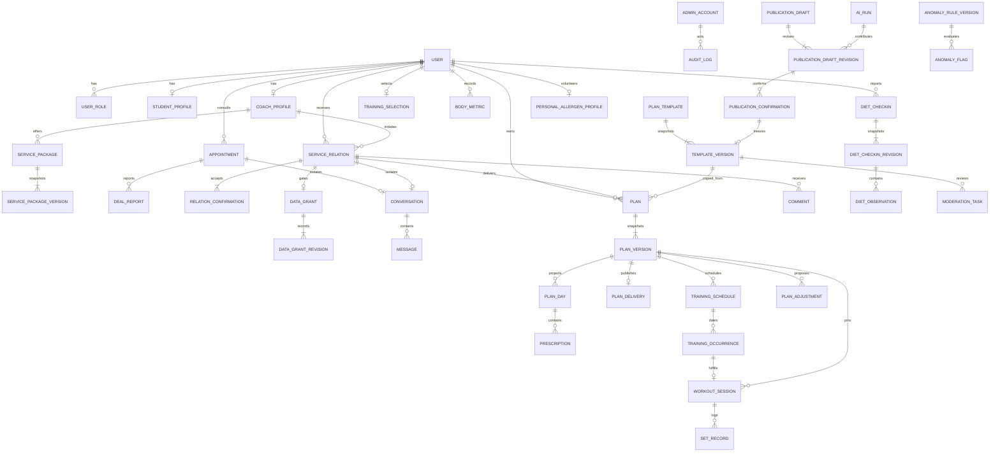
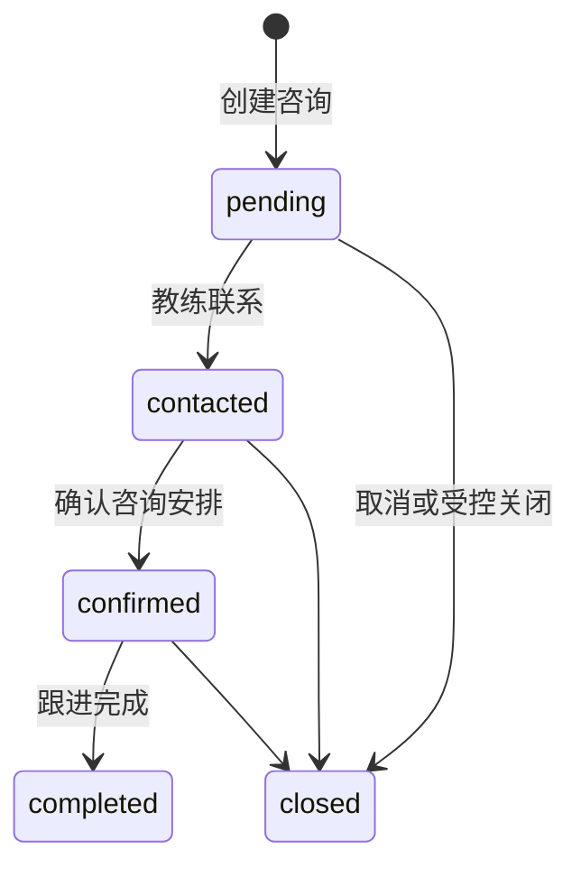
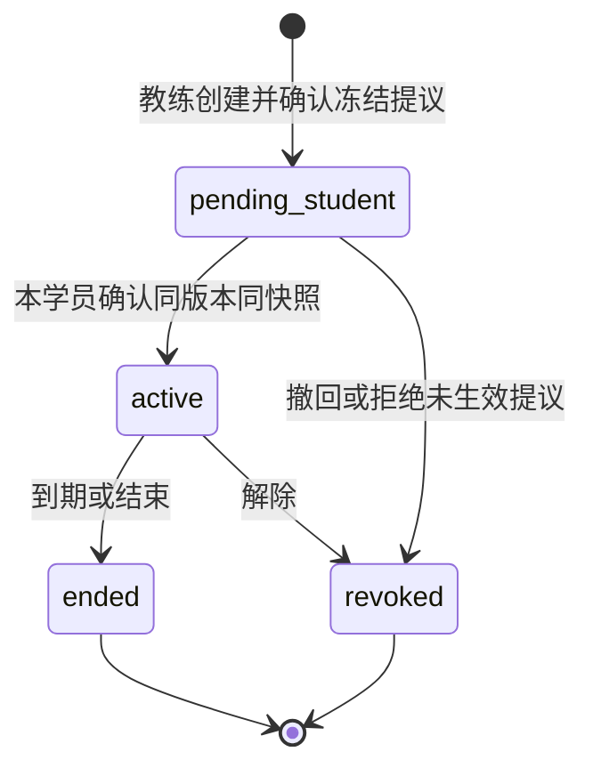
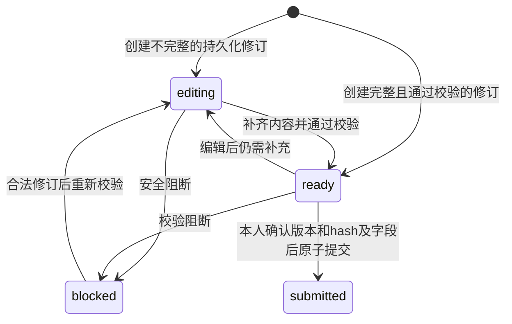

# Nerae 数据模型与 ER 设计

> 版本：v1.2 · 2026-10-23
> 依据：[PRD](PRD.md)、[ER 与 API 审核报告 v1.0](ER与API审核报告-v1.0.md)及本轮 Lead 决策；接口对照：[OpenAPI](../api/openapi.yaml)。
> 范围：逻辑数据模型、可持久化字段、约束与状态机；**不是 DDL、迁移脚本或已经建库的证明**。字段类型是实现设计输入，仍需迁移、事务、权限与并发测试验证。

## 1. 边界与本轮决策

1. **咨询、成交自报、服务关系分离**。咨询状态和成交自报均不能激活服务关系、授予数据访问权或证明支付事实；本阶段不增加支付、订单或分账实体。
2. **教练发起即教练确认**。新关系从 `pending_student` 开始；学员只能确认同一版本及服务说明快照，成功后直接 `active`，不再要求重复的教练确认。
3. **身份、关系、数据授权是不同条件**。有效教练身份不等于可以读学员健康数据；结束/解除关系与授权失效原子生效。普通档案的公开设置不能覆盖敏感字段授权。
4. **公域与私域版本独立**。`template_version` 保存公开模板完整内容；`plan_version` 保存私人训练/饮食计划完整内容。另存、编辑、回滚、训练与饮食记录均固定来源版本，不依赖可变正文。
5. **AI 只产生待确认内容**。发布草稿、草稿修订、字段来源、人工确认、最终公开版本形成可追溯链。确认仅证明当事人的确认动作，不证明专业安全性或营养数值正确。
6. **自评不是实食**。饮食餐次状态、diary/依从性自评、实际饮食的自述观察、AI 提取待确认观察分别建模；证据不足必须得到 `insufficient_data`。
7. **最小健康数据**。个人过敏原可选、单独同意、单独授权并加密；未知、未报告过敏与拒绝提供不是同一状态。不建立公开健康数据资源。
8. **未获授权的策略仍待定**。多人教练并行服务、抽检比例、响应/留存/幂等期限等不由本 ER 擅自冻结；规则版本化不等于已经专业审核。

## 2. 类型、版本与通用约束

### 2.1 表字典读法

| 记号/字段 | 类型与约束 |
|---|---|
| `id`、`*_id` | `bigint unsigned`；API 为字符串。`PK` 为主键，`UK(...)` 为唯一约束，`REF` 为必须校验的引用关系 |
| `?` | 允许为空；未标 `?` 的字段非空。空值不是空字符串、0 或“未知”的替代品 |
| `version` / `revision` | `int unsigned`；持久化版本从 1 开始；0 仅表示尚无授权等明确的初始状态 |
| 时间 | `datetime(3)`，UTC；API 为 ISO 8601。业务日期用 `date`，日期计算使用明确的业务时区 |
| 通用审计列 | 可变实体有 `created_at`、`updated_at`；不可变版本/事件只有 `created_at`。创建者使用经认证的主体，不接受客户端指定 |
| 软删除 | 可删除资源有 `deleted_at datetime(3)?`；不因此解除历史版本、幂等键、审计及记录引用。最终删除/匿名化另按保留策略执行 |
| 枚举/代码 | `varchar(32)`，明确允许集合；字段路径/规则代码可用更长长度。不靠任意字符串绕过枚举 |
| `hash` | `char(64)`，规范化内容的 SHA-256，区分大小写；hash 不是数据访问凭据 |
| JSON | 存储类型为 `json`，必须服从本章及对应 API 的具名结构；不得用任意 JSON 替代必填字段、互斥类型与引用校验 |
| 加密正文 | `*_enc blob` + `key_id varchar(64)`，包含认证加密所需元数据；不在普通日志/事件/错误中保存解密正文 |
| 主体 | `(actor_kind, actor_id)`；kind 为 `user/admin/system`，必须对应真实主体。不同 kind 的相同数值 ID 不是同一个人 |
| 金额 | 报价用 `int unsigned` 分；成交自报仅可选区间且 `min <= max`，不据此构建已验证收入/GMV |
| 引用完整性 | 下文 REF、复合唯一键、同所属人与版本一致性都是必须满足的约束；最终由物理外键、事务或其他方式实现需另行验证，不预先豁免 |

### 2.2 乐观版本与内容版本

- `expectedVersion` 必须与**目标资源当前版本**原子比较；拒绝先读后无条件覆盖。不同资源的同值版本不等价；版本冲突返回契约中的冲突响应，不能自动合并为一次授权或确认。
- `service_relation.version` 是关系状态的并发令牌；`offered_version` 是双方接受的冻结提议版本。学员确认以当前关系版本定位唯一服务说明快照；状态变化不重写双方已接受的提议版本。
- `data_grant.version` 独立于关系版本。首次 PUT 必须 `expectedVersion=0`，每次成功 PUT（含空范围）递增；历史版本不能恢复旧授权。
- `plan.version` 是当前内容版号；编辑与回滚均生成新 `plan_version`，不能覆写旧版。`published_version` 单独指向教练已确认交付的版本；发布按当前内容版号及状态比较，不伪造一个内容修订。
- `publication_draft.revision` 是草稿修订令牌，对外映射为 `PublishDraft.version` / `PublishAssistResponse.draftVersion`；提交时使用 `expectedDraftVersion`。任何可编辑正文或来源元数据变更都递增，旧确认失效；`template_version.version` 是该模板独立的公开内容版号。
- 会话和打卡有自己的修改版本；它们引用的 `planVersion` 不是该修改版本。客户端必须分别保存，不能把当前计划版号当作历史记录的版号。
- 发布 `content_hash` 覆盖规范化的 `planType/title/goal/content/visibility` **及字段来源元数据**，不含只读 ID、计数、时间或服务器来源标签。草稿可见性为 private/public/link，公开提交只能选择 public/link 且必须等于已确认草稿；修改可见性也递增修订并重新确认。哈希规范版本须固定；数组顺序保留，空值处理及数值表示唯一化。最终版本正文及可见性必须与被确认草稿逐项相同。
- 统一冲突语义：过期版本为 `412`，非法状态或幂等同键异摘要为 `409`；幂等重放不再执行版本推进。数据库空值与 API 的省略/nullable 分别处理，不能把本字典的 `?` 理解为所有请求都接受 JSON null。

## 3. 核心 ER 图

图只展示核心联系。可空引用、同主体校验、复合约束及两种会话上下文的互斥，以后续字典为准。

## 4. 身份、档案与授权

### 4.1 `user`、`user_role` 与教练资料

| 实体 | 字段、类型与约束 |
|---|---|
| `user` | `id PK`；`openid varchar(64) UK`；`unionid varchar(64)?`；`phone_enc blob?`、`key_id varchar(64)?`；`nickname varchar(64)?`、`avatar_asset_id ID? REF file_asset`；`gender tinyint`（0/1/2）；`birth_year smallint?`、`age_verified_at datetime(3)?`；`status varchar(16)`（active/disabled）；`token_version int unsigned >=1`；`last_active_at datetime(3)?`；通用时间列 |
| `user_role` | `id PK`；`user_id ID REF user`；`role varchar(16)`（student/coach）；`status varchar(16)`（active/disabled）；`UK(user_id,role)`。**不含 admin**，选择教练入口不等于审核通过 |
| `coach_profile` | `user_id PK REF user`；`real_name_enc blob?`、`key_id varchar(64)?`；`bio text`、`style varchar(128)?`、`years smallint unsigned`；`specialties json`（字符串数组）；`service_mode varchar(24)`（online/online_offline）；`city varchar(64)?`；`cert_status varchar(16)`（unverified/pending/approved/rejected）；`status varchar(16)`（draft/pending/active/suspended）；`version int unsigned`；评分/响应/排名是可重算读模型，不作履约事实 |
| `coach_cert` | `id PK`；`coach_id ID REF coach_profile`；`cert_type varchar(64)`；`file_asset_id ID REF file_asset`；`status varchar(16)`（pending/approved/rejected）；`reviewed_by_admin_id ID? REF admin_account`、`reviewed_at datetime(3)?`、`note text?`。文件默认私有，公开的仅是经允许的认证展示信息 |

### 4.2 `admin_account`：独立管理主体

| 字段 | 类型 | 约束/含义 |
|---|---|---|
| id | bigint unsigned | PK，不复用普通 user ID 作为身份 |
| username / username_normalized | varchar(128) / varchar(128) | 规范化规则固定；`UK(username_normalized)`，不得靠大小写/空白产生重复账号 |
| password_hash | varchar(255) | 非空，仅安全口令哈希及算法参数；不存明文或可逆口令 |
| status | varchar(16) | active / disabled；临时锁定另由 locked_until 表达 |
| token_version | int unsigned | >=1；改密、停用、强制登出递增；令牌必须匹配当前值 |
| roles / permissions | json / json | 受控管理角色集合与对应权限代码集合；角色白名单及角色到权限映射版本化，不接受普通登录请求的角色声明 |
| password_changed_at / last_login_at | datetime(3) / datetime(3)? | 安全审计时间 |
| failed_login_count / locked_until | int unsigned / datetime(3)? | 风控状态；次数、锁定期限是待核定策略，不在 ER 冻结 |
| created_by_admin_id | bigint unsigned? | REF admin_account；仅初始化主体可为空，并留独立审计 |

后台登录和审计使用此主体；常规管理权限不隐含健康正文读取权。敏感客服访问需独立审批、最小范围和审计，不能用 `admin` 身份绕过授权边界。

### 4.3 `student_profile` 与可选个人过敏原

| 实体 | 字段、类型与约束 |
|---|---|
| `student_profile` | `user_id PK REF user`；`goal varchar(32)`、`experience varchar(16)?`；`equipment json`（枚举数组，缺省为空）；`days_per_week tinyint unsigned?`（1–7）；`session_minutes smallint unsigned?`（15–180，仅输入范围）；`height_cm decimal(6,2)? >0`、`weight_kg decimal(6,2)? >0`（仅兼容历史身体字段，不由新档案接口采集）；`injury_notes_enc blob?`、`key_id varchar(64)?`、`injury_consent_id ID? REF health_consent`；`privacy_level varchar(16)`（private/coaches/public，仅兼容已有偏好，新读写模型不暴露健康公开开关）；`version int unsigned`。goal/experience/equipment 枚举与具名 API 一致；hasInjuryNotes 仅为本人读模型投影，不能经 profile scope 向教练或公众泄露 |
| `health_consent` | `id PK`；`user_id ID REF user`；`purpose varchar(32)`（allergy_collection/injury_collection）；`notice_version varchar(32)`；`status varchar(16)`（granted/withdrawn）；`granted_at datetime(3)?`、`withdrawn_at datetime(3)?`；`version int unsigned`；`UK(user_id,purpose)`。本人自愿采集同意与向某教练的数据授权不同；同意与撤回另留最小审计事件 |
| `personal_allergen_profile` | `user_id PK REF user`；`status varchar(24)`（unknown/known/none_reported/declined）；`allergens_enc blob?`、`key_id varchar(64)?`；`taxonomy_version varchar(32)?`；`consent_id ID? REF health_consent`；`version int unsigned`；`reported_at datetime(3)?`、`deleted_at datetime(3)?`。未撤回/删除的 known 资料必须为非空过敏原清单且有有效采集同意；撤回后只留最小版本墓碑，不留可业务读取的加密载荷；none_reported 是本人明确“未报告已知过敏”，不是医学排除；unknown/declined 不得伪造空清单为安全依据 |

`privacy_level=public` 只可影响明确允许公开的非健康资料，不使身高、体重、伤病、饮食、个人过敏原或照片公开。未提供过敏原不得阻止非依赖该信息的基本功能；任何个人过敏原匹配都必须保留未知态。

`PUT /me/allergy-profile` 以 expectedVersion 比较本人资料版本（首次 0），同时记录显式采集同意；`DELETE /me/allergy-profile` 比较版本后撤回该采集同意并请求删除，禁止后续业务读取或模型使用。保留必要的同意撤回证明和版本墓碑，不将其转换成 none_reported；仅限必要审计的历史材料隔离限权。伤病字段省略表示不改，`injuryNotes:null` 明确清除；非空写入需 injuryConsent=true 及必要性校验。采集同意已撤回时，即使某关系仍有 allergy/injury scope 也不能继续使用已撤回资料，重新提供需新的明确同意与有效版本。

### 4.4 `data_grant` 与 `data_grant_revision`

| 实体 | 字段、类型与约束 |
|---|---|
| `data_grant` | `id PK`；`relation_id ID UK REF service_relation`；`student_id ID`、`coach_id ID` 必须等于关系双方；`scopes json`（下表枚举去重数组）；`version int unsigned >=1`；`granted_at datetime(3)?`、`revoked_at datetime(3)?`；`changed_by_kind varchar(16)`、`changed_by_id ID`；通用时间列 |
| `data_grant_revision` | `id PK`；`grant_id ID REF data_grant`；`version int unsigned`；`scopes json`；`change_reason varchar(24)`（student_put/relation_end/relation_revoke/expiry）；`actor_kind varchar(16)`、`actor_id ID`；`relation_version int unsigned`；`created_at datetime(3)`；`UK(grant_id,version)`，只追加 |

| scope | 允许的字段/资源范围 | 明确不含 |
|---|---|---|
| profile | 目标、训练经验、器械、每周天数、每次时长等基础训练偏好 | 伤病、身体测量、饮食、过敏原、照片 |
| training | 本人训练会话、组记录、训练完成感受及相应私人训练记录 | 身体趋势、饮食、伤病及其他关系的私信 |
| body | 身高、体重、体脂、围度、睡眠等身体记录 | 伤病、过敏原、饮食和公开展示权限 |
| injury | 单独受控的伤病信息 | 自动诊断、公开回显、其他健康类别 |
| diet | 饮食计划私人内容、餐次状态、自评及带来源的饮食观察 | 个人过敏原；计划营养值不是实际摄入 |
| allergy | 自愿提供的个人过敏原状态及清单 | 其他健康字段；不因 diet/profile 自动获得 |

授权协议：

- 无记录时返回空范围、`version=0` 的虚拟状态，默认拒绝访问；第一笔 PUT（包括 `scopes=[]`）比较 0 后落第一版。
- **每次 PUT 都必须提供 `expectedVersion`**；`scopes=[]` 表示撤回，不能靠省略 scopes 或默认 `revoked=false` 恢复授权。成功写入及历史事件在同一原子操作中完成。
- 只有该关系的学员可设置范围；仅有效关系可增加授权。`ended/revoked` 是终态，空范围 PUT 也不得借机重新激活关系。
- 结束/解除时，关系终态、授权清空及版本推进、授权历史在同一事务边界生效；即使此前无授权，也形成撤回墓碑以阻断迟到的 `expectedVersion=0` 写入。
- 每次读取、文件下载、AI 取数及异步结果交付都重查关系、服务期及当前 scopes；任务开始时的旧授权快照只供审计。缓存、历史授权与已生成摘要不能延长权限。
- 数据选择按字段白名单投影，不允许“有 profile 即返回整张档案”。本人所有权不因撤回而消失，教练写过计划也不等于获得其他健康记录的读取权。

## 5. 咨询、套餐与服务关系

### 5.1 咨询与成交自报

| 实体 | 字段、类型与约束 |
|---|---|
| `appointment` | `id PK`；`appointment_no varchar(32) UK`；`student_id ID REF user`、`coach_id ID REF coach_profile`（不同主体）；`package_id ID? REF service_package`；`form json`（goal、level 必填，availableTime/budgetRange/note 可选，边界服从 API）；`status varchar(16)`（pending/contacted/confirmed/completed/closed）；`version int unsigned`；`contacted_at/confirmed_at/closed_at datetime(3)?`；`close_reason varchar(32)?`；通用时间列。这里的 confirmed 仅为咨询跟进状态 |
| `deal_report` | `id PK`；`appointment_id ID REF appointment`；`reporter_user_id ID` 必须为该咨询教练；`status varchar(24)`（unreported/won/lost/still_talking/unreachable）；`amount_min_cents/amount_max_cents int unsigned?`（成对为空或同时非空且 min<=max）；`revision int unsigned`；`reported_at datetime(3)`；`UK(appointment_id,revision)`，只追加。appointment 的 dealStatus/amountRange 是最新自报读模型 |
| `invite` | `id PK`；`coach_id ID REF coach_profile`；`code varchar(64) UK`；`channel varchar(64)?`；`created_at datetime(3)`。邀请只记来源，不自动建立关系、确认成交或授予健康权限；绑定数为派生统计 |

### 5.2 `service_package` 与 `service_package_version`

| 实体 | 字段、类型与约束 |
|---|---|
| `service_package` | `id PK`；`coach_id ID REF coach_profile`；`version int unsigned >=1`；`status varchar(16)`（draft/active/inactive）；`current_version_id ID REF service_package_version`；通用时间列。当前引用必须属于本套餐 |
| `service_package_version` | `id PK`；`package_id ID REF service_package`；`version int unsigned >=1`；`template_type varchar(24)`（experience/monthly/monthly_deep/session）；`title varchar(128)`；`description text?`；`price_cents int unsigned`；`duration_days int unsigned >0`；`session_count/plan_updates smallint unsigned?`（保留旧字段，新接口不接收）；`includes json`（1–30 个非空服务说明字符串，每项最多 512 字符）；`response_sla_hours int unsigned >0`；`has_video boolean`；`snapshot json`（上述全部服务说明与报价）；`content_hash char(64)`；`created_by_user_id ID`；`created_at datetime(3)`；`UK(package_id,version)`，正文不可变 |

套餐编辑追加版本，不能追溯改变既有关系。报价是教练服务说明，不是平台订单或已付款凭证；套餐自填的响应承诺与平台统一 SLA 是不同概念。

### 5.3 `service_relation`

| 字段 | 类型 | 约束/含义 |
|---|---|---|
| id | bigint unsigned | PK |
| student_id / coach_id | bigint unsigned | REF user / coach_profile；不同主体，教练从认证身份取得 |
| appointment_id | bigint unsigned? | REF appointment；可空，非空时双方必须一致；咨询不是创建关系的隐含前置状态 |
| package_id / package_version_id | bigint unsigned? / bigint unsigned? | 成对为空或指向同一教练的具体套餐版；绝不只保存可变 package_id |
| package_version | int unsigned? | 与冻结套餐版号一致，供读模型使用 |
| terms_snapshot | json | 非空、完整服务说明；含经过校验的服务内容及选定套餐说明/报价快照，不是任意客户端对象 |
| terms_hash / hash_version | char(64) / varchar(32) | 规范化 terms_snapshot 的摘要及规范版本 |
| offered_version | int unsigned | 本次冻结提议版本；新关系创建为 1，确认后不重写 |
| version | int unsigned | 状态并发令牌，创建为 1 |
| status | varchar(24) | pending_student / active / ended / revoked；新协议无 pending_coach 中间态 |
| start_at / end_at | datetime(3) | 必填，start_at < end_at；到期不能因后台任务延迟继续授予访问 |
| coach_confirmed_at / student_confirmed_at | datetime(3) / datetime(3)? | 教练创建时即记录；汇总自确认记录，不可由客户端指定 |
| activated_at / ended_at | datetime(3)? / datetime(3)? | active 必有 activated_at；终态必有 ended_at |
| ended_reason | varchar(32)? | completed / student_end / coach_end / dispute / revoked，须与操作者及状态匹配 |
| created_by_user_id | bigint unsigned | 必须为 coach_id；通用时间列 |

索引：`(student_id,status)`、`(coach_id,status)`、`(end_at,status)`。不再用 `(student_id,coach_id,start_at)` 推断“重复意图”；请求幂等由专门记录保证。并行多教练/同对主体重叠服务是否允许仍待业务确认，不以缺少全局唯一键宣称已批准该产品能力。

**创建输入与冻结**：`POST /coach/relations` 接受 `studentId`、可省略的 `packageId/expectedPackageVersion`、`startAt/endAt` 与服务说明 `terms`。terms 使用 `ServiceTermsInput`：非空 title、非负 priceCents、非空 includes 字符串数组、正整数 responseSlaHours。有套餐时必须同时提供 expectedPackageVersion；服务端核对归属、可用状态及所期望的套餐版本，将权威套餐字段与允许的说明输入校验后生成完整快照；版本过期为 412，不能信任客户端伪造的套餐价格/内容。无套餐时两项输入省略、持久化套餐引用为空，terms 仍必须完整。校验、写关系、写教练确认、幂等结果在同一原子边界内完成；不先返回“已创建”再异步补确认。

### 5.4 `relation_confirmation`

| 字段 | 类型 | 约束/含义 |
|---|---|---|
| id / relation_id | bigint unsigned / bigint unsigned | PK / REF service_relation |
| actor_user_id / side | bigint unsigned / varchar(16) | side=coach/student，actor 必须为关系对应本人 |
| offered_version / relation_version_at_confirmation | int unsigned / int unsigned | 接受的提议版本及校验时的状态版本 |
| terms_hash | char(64) | 必须匹配被接受的冻结快照 |
| source | varchar(16) | relation_create / confirm；新关系教练证据来自创建 |
| confirmed_at | datetime(3) | 服务器时间，只追加 |

`UK(relation_id,offered_version,side)`，不得为同一方重复记确认。创建：教练证据绑定第 1 版；学员提交匹配的 `expectedVersion/termsHash` 与 `acknowledged=true`，在事务内核对快照和既有教练证据后追加学员证据，再将关系置 active 并递增状态版本。版本不符、非本人或已终结均不能确认。

兼容的 `POST /coach/relations/{id}/confirm` 不新增另一轮教练确认、不推进到 pending_coach、不延长服务期；仅核验已有同版本教练证据后按契约幂等返回。不能用旧兼容路径激活未经学员确认的关系或复活终态；如需处理旧数据，必须先验证双方对同一快照的证据，不能批量推定已确认。

## 6. 内容快照、公域版本与私人计划

### 6.1 严格内容联合类型

所有可发布/交付/另存的正文都为 `content.kind=training|diet` 的互斥联合类型，不再以“训练 days + 可选 diet + 任意对象”混装。

| 结构 | 持久化内容与校验 |
|---|---|
| 公共快照头 | `schema_version`（内部正整数）、`planType/title/goal`；按资源保存 visibility 等允许的展示属性。摘要/适用范围仅在相应资源提供时保存，不能凭空要求客户端提交 API 不接收的字段；正文与来源引用分离 |
| training | `kind=training`；`weeks`（1–52）；`days` 为具名训练日数组；每项含 `weekIndex`（1–52）/`dayIndex`（1–7，同版组合唯一）、`title`、`type`（strength/cardio/rest/mobility）、`items`；动作项有 exerciseId、sets、repsMin，可选 repsMax/weightKg/rpe/restSec/notes；要求 repsMin<=repsMax（有上限时）。版本同时冻结使用的动作库名称/提示，不能依赖动作库后续改写；上述容量上限不是训练推荐量 |
| diet | `kind=diet`；`nutritionBand` 含 energyMinKcal/energyMaxKcal/proteinMinGPerKg/proteinMaxGPerKg/basis；`dietType`（normal/vegetarian/other）；`allergenAssessment` 与 `notSuitable`；`meals` 每项含 dayIndex、slotKey、label、foods，`UK(dayIndex,slotKey)`。食物项含 name、quantity、preparation（raw/cooked/unknown）、allergenAssessment，可选 foodId/alternatives；quantity 为正数 value、unit（g/ml/piece/serving）及可选 description。餐数由餐次推导；必要时保存内部字典来源版与估算来源。**私人副本也保存整份内容** |
| 数值 | 计数/顺序使用整数，重量/份量/营养数值使用 `decimal` 或规范化 JSON number；计数为正，数量非负，区间 min<=max；空值/缺失不当作 0。技术范围校验不等于健康阈值 |
| TrainingDayInput | 不接受 `id`；服务端创建版本时分配日 ID，客户端不得伪造跨计划/跨版本日引用 |
| TrainingDay 读模型 | 必含稳定 `id` 及可确定的所属 `planVersion`/模板版号；同一版本多次读取 ID 不变。新版本/另存可以分配新 ID，不能用数组下标或标题代替日 ID |

本轮采用**整份快照**而非差异链。`schema_version` 允许日后做显式格式迁移；转换不能悄悄改变历史内容。公域下架不级联删除合法私人副本和已发生记录，但可另附不含个人健康信息的安全提示。

### 6.2 `plan_template` 与独立的 `template_version`

| 实体 | 字段、类型与约束 |
|---|---|
| `plan_template` | `id PK`；`author_kind varchar(16)`（user/admin）与 `author_id ID`；`plan_type varchar(16)`（training/diet，必须等于正文 kind）；`latest_version int unsigned`；`published_version_id ID? REF template_version`；`status varchar(16)`（pending/published/hidden/rejected）；`deleted_at datetime(3)?`；通用时间列。标题/目标/计数等列表字段只是当前公开版投影，不能当正文真源 |
| `template_version` | `id PK`；`template_id ID REF plan_template`；`version int unsigned >=1`；`schema_version int unsigned`；`snapshot json`（独立完整头与正文）；`content_hash char(64)`、`hash_version varchar(32)`；`visibility varchar(16)`（public/link）；`source_tag varchar(16)`（official/coach/student，服务端生成）；`origin_template_version_id ID? REF template_version`；`publication_draft_id ID REF publication_draft`、`draft_revision int unsigned`、`confirmation_id ID REF publication_confirmation`；`ai_run_id ID? REF ai_run`、`field_provenance json`；`review_status varchar(16)`（pending/approved/rejected）；`status varchar(16)`（pending/published/hidden/rejected）；`review_policy_version varchar(32)`；`published_at datetime(3)?`；`created_at datetime(3)`；`UK(template_id,version)`，正文不可变 |

约束：

- `template_version` **不依附私人 plan_id**；历史公开详情、审核、分享、收藏来源和另存都定位具体公开版。未指定版号的列表/详情只解析当前可见版，响应仍必须带确定版号；后续另存提交该版号，不能在后台换成“最新版”。
- 新修订的审核不覆写旧版。`published_version_id` 只可指向本模板的已通过且可见版本；下架某版后不得通过旧分享链接绕过该版可见性，未知/不可见资源按统一契约响应。
- `source_tag/author_type` 来自经认证的发布主体与有效身份，客户端不得设为 coach/official；普通用户选择登录角色不能取得官方标识。发布时标签保留快照，当前教练资格变化另按真实状态显示，不把历史标签当永久资质背书。
- `confirmation_id` 必须属于同一发布者、同一草稿修订及 `content_hash`，其估算字段集合与该修订一致；最终可编辑内容只能从被确认修订复制。
- 原 `diet_plan_template` 如保留，只作为 `template_version_id PK REF template_version` 的**只读饮食索引投影**，字段为 `kcal_min/max decimal(10,2)`、`protein_min/max_g_per_kg decimal(8,3)`、`meals_per_day smallint`、`diet_type varchar(16)`、`allergens json`。不能继续作为随模板原地更新的餐单真源。

### 6.3 `plan`、`plan_version` 与日明细

| 实体 | 字段、类型与约束 |
|---|---|
| `plan` | `id PK`；`owner_user_id ID REF user`；`relation_id ID? REF service_relation`、`coach_id ID? REF coach_profile`（两者成对，关系学员必须等于 owner）；`source varchar(16)`（self/template/coach/ai）；`plan_type varchar(16)`（training/diet）；`source_template_version_id ID? REF template_version`；`version int unsigned >=1`；`published_version int unsigned?`；`status varchar(16)`（draft/active/archived）；`deleted_at datetime(3)?`；通用时间列 |
| `plan_version` | `id PK`；`plan_id ID REF plan`；`version int unsigned >=1`；`schema_version int unsigned`；`snapshot json`（含完整训练或饮食正文及标题等）；`content_hash char(64)`、`hash_version varchar(32)`；`created_by_user_id ID REF user`；`ai_run_id ID? REF ai_run`、`field_provenance json`；`copied_from_template_version_id ID? REF template_version`；`restored_from_version int unsigned?`（同一计划既存版）；`created_at datetime(3)`；`UK(plan_id,version)` |
| `plan_day` | `id PK`，作为 TrainingDay.id；`plan_version_id ID REF plan_version`；`week_index/day_index smallint unsigned >0`；`title varchar(128)`、`type varchar(16)`（strength/cardio/rest/mobility）、`notes text?`；`UK(plan_version_id,week_index,day_index)`；只属于 training 版本，按快照建立，不允许单独改写 |
| `prescription` | `id PK`；`plan_day_id ID REF plan_day`；`exercise_id ID REF exercise_library`；`exercise_snapshot json`（name、提示/禁忌等被使用字段）；`sets smallint unsigned`（1–100）；`reps_min smallint unsigned`（1–1000）、`reps_max smallint unsigned?`（1–1000，非空时 min<=max）；`weight_kg decimal(8,2)? >=0`、`rpe decimal(3,1)?`（1–10）、`rest_sec int unsigned?`（0–3600）；`order_index smallint unsigned`；`notes text?`；`UK(plan_day_id,order_index)`；容量边界仅防无效输入 |

完整快照为版本真源；`plan_day/prescription` 是同一不可变版本的可索引结构，须在同一原子写入中生成并保持一致，不形成双重可编辑真源。饮食不需要假装训练日；饮食餐次与食物内容可直接由具名快照持久化。

- 另存指定 `template_version` 后建立新的 plan 与首版完整 snapshot；源模板、食物库、动作库被编辑/隐藏都不能改变私人内容。
- 改米饭份量等饮食编辑与训练编辑一样需要 expectedVersion，并创建新完整版本。响应使用私人 Plan 读模型，不复用公开模板响应。
- 回滚校验当前 expectedVersion，将指定历史 snapshot 复制成**新版本**并记录来源；不能把当前版号倒退或重写历史训练日。
- 本人自建/另存计划由本人编辑；关系交付计划由对应教练通过交付接口编辑，学员读取的是已发布版而不是教练未确认草稿。本人拥有记录和历史副本，不因此获得伪造教练交付的权限。
- **`owner_user_id=学员` 不是教练草稿的读取授权**。`GET /me/plans`、`/me/plans/{id}`、`/me/diet-plans`、`/me/diet-plans/{id}` 与关系计划列表必须对 source=coach 选择 `published_version` 的标题/goal/content/日 ID 等整版投影；列表排除未发布项，未发布详情对学员返回 404。学员响应的 `version` 也是实际展示版号，不混用教练当前草稿版号；仅教练编辑读模型看到最新内容头及独立 publishedVersion。

### 6.4 教练交付：`plan_delivery` 与 `comment`

| 实体 | 字段、类型与约束 |
|---|---|
| `plan_delivery` | `id PK`；`plan_id ID`、`plan_version int unsigned`，复合 REF plan_version；`relation_id ID REF service_relation`；`coach_id ID REF coach_profile`；`content_hash char(64)`；`ai_run_id ID? REF ai_run`；`confirmed_by_user_id ID`（该教练）；`confirmed_at/published_at datetime(3)`；`UK(plan_id,plan_version)`，只追加。所有人/关系/版本必须与 plan 一致 |
| `comment` | `id PK`；`relation_id ID REF service_relation`；`author_user_id ID`（该关系教练）；`text varchar(2000)` 非空；`session_id ID? REF workout_session`、`plan_id ID? REF plan`（至少一项非空，可同时提供但必须对应同一学员的合法内容）；`session_version int unsigned?`、`plan_version int unsigned?`（由服务端固定所评版本）；`required_scopes json`（服务器依据引用/取数范围生成）；`ai_run_id ID? REF ai_run`；`confirmed_by_user_id ID`、`confirmed_at datetime(3)`；`created_at datetime(3)`。API 的 aiAssisted 根据有效来源推导，不接受客户端背书；目标不能跨关系附带其他教练的私有内容 |

- `POST /coach/relations/{id}/plans`：仅该关系教练、有效关系；创建归学员所有、归该关系交付的训练或饮食草稿。
- `PUT /coach/plans/{id}`：比较 expectedVersion，追加完整内容版本；既有 published_version 不被未发布草稿覆盖。
- `POST /coach/plans/{id}/publish`：比较当前版与状态，人工确认准确内容后原子写 delivery 并更新 published_version；同版重复发布不产生重复交付。AI 生成成功不等于此步骤已完成。
- `GET /relations/{id}/plans`：学员得到已交付固定版本，不能读到教练待确认稿；教练按关系及授权边界访问。历史个人内容的保留不等于教练有永久读取权。
- `POST/GET /relations/{id}/comments`：教练明确发送才产生点评；GET 仅限合法参与者。读取所引用的训练/饮食等健康内容仍需对应 scope，关系终结/撤权后不能经评论附件、AI 摘要或聚合绕过。通知只引用评论 ID，不复制敏感正文。

## 7. AI 发布草稿、字段来源与确认

### 7.1 可落库实体

| 实体 | 字段、类型与约束 |
|---|---|
| `publication_draft` | `id PK`；`owner_kind varchar(16)`（user/admin）、`owner_id ID`；`target_template_id ID? REF plan_template`；`source_plan_id ID?`、`source_plan_version int unsigned?`（成套且发布者有权复制）；`plan_type varchar(16)`；`revision int unsigned >=1`；`snapshot json`（当前发布输入，editing/blocked 可缺 title/goal/content；ready/submitted 必须完整）；`visibility varchar(16)`（private/public/link）；`content_hash char(64)?`、`hash_version varchar(32)`；`ai_run_id ID? REF ai_run`；`field_provenance json`、`field_suggestions json`、`missing_fields json`、`estimated_field_paths json`；`status varchar(16)`（editing/ready/blocked/submitted）；`submitted_template_version_id ID? REF template_version`；通用时间列 |
| `publication_draft_revision` | `id PK`；`draft_id ID REF publication_draft`；`revision int unsigned`；`snapshot json`、`visibility varchar(16)`、`content_hash char(64)?`、`hash_version varchar(32)`；`readiness varchar(16)`（editing/ready/blocked）；`ai_run_id ID? REF ai_run`；`field_provenance/field_suggestions/missing_fields/estimated_field_paths json`；`created_by_kind varchar(16)`、`created_by_id ID`；`created_at datetime(3)`；`UK(draft_id,revision)`；只追加，作为当前草稿投影的历史真源 |
| `publication_confirmation` | `id PK`；`draft_id ID`、`draft_revision int unsigned`，复合 REF publication_draft_revision；`actor_kind varchar(16)`、`actor_id ID`（必须为草稿发布者）；`content_hash char(64)`；`visibility varchar(16)`（public/link，须等于该修订）；`estimated_field_paths json`（确认过的当前字段路径集合）；`acknowledged boolean`（必须 true）；`confirmed_at datetime(3)`；`UK(draft_id,draft_revision,actor_kind,actor_id)`，同一修订的不同摘要不可共存 |

`field_provenance` 是具名对象数组：每项含 `path`（JSON Pointer）、`provenance`（user_provided/ai_estimated/unknown）、`needsConfirmation`，可空来源资源及版本、aiRunId；内部 `origin_kind` 可细分 user_input/source_snapshot/ai_extracted/ai_estimated/unknown。对外 `FieldSuggestion` 使用 path、可选 valueText/sourceRef、provenance、needsConfirmation，不把内部来源细分强加为新增请求字段。继承的 AI 来源仍标 AI，不因复制而改为“本人原始事实”。

AI 路径与需确认集合由服务端运行记录和编辑历史生成，客户端不能通过删除 AI 标记、伪造 aiRunId、发送空路径数组来绕过确认。信息不足时只保存已知输入、fieldSuggestions 与 missingFields：API 省略 content/hash，而非返回 null 或编造完整营养值。ready/submitted 才具有完整内容、确定 hash 和可确认的全部字段；editing/blocked 仍能被本人读取和补全。

### 7.2 确认不变量

1. 服务端保存草稿修订后才返回对应 `draftId/draftVersion`；完整修订再返回可确认的 contentHash/estimatedFieldPaths。持久化 revision 对应 `PublishDraft.version`，AI 的 ready 也不等于公开发布。
2. 本轮无独立公开“确认草稿”接口。`PublishSubmit` 的 `draftId/expectedDraftVersion/visibility` 与内嵌 `confirmation{contentHash,estimatedFieldPaths,acknowledged:true}` 共同表达本人确认；服务端先鉴权和比较，再原子保存确认记录及不可变 template_version/审核任务。
3. 确认必须同时绑定 actor、draft、revision、hash 和服务端要求的估算字段路径集合；路径去重、必须真实存在，漏项/未知项均不接受。纯手填也要确认最终提交内容，估算路径可为空。只能提交 ready 且 visibility=public/link 的当前修订。
4. 保存任何正文修改、重跑 AI、改变字段来源或调整可见性都新建修订并重新判定 editing/ready/blocked；即使后来改回相同文字，也不能用旧 revision 的确认。版本过期 412，漏确认/无效内容 422，状态冲突 409。
5. 提交不接受任意 draft 对象替代持久化证据；在事务内再次比较当前 revision/hash/visibility、完整性和适用规则。最终 template_version 保存被确认正文、来源、ai_run_id、draft_revision、confirmation_id、visibility 和 hash；`UK(confirmation_id)` 防止同一次确认产生多个最终版本。
6. submitted 的原版不被后续编辑改写；如允许继续修订，必须创建后继修订并重新确认，旧审核结果不自动沿用。来源标签由服务端生成；发布者确认不能替代专业审查，确认后的估算数值仍须标明估算性质。

### 7.3 `ai_run`、`prompt_version` 与字典

| 实体 | 字段、类型与约束 |
|---|---|
| `ai_run` | `id PK`；`actor_kind varchar(16)`、`actor_id ID`；`relation_id ID?`；`type varchar(32)`（plan_generate/plan_adjust/comment/weekly_report/interpret/analyze/publish_extract/chat/anomaly）；`provider varchar(64)`、`model varchar(128)`；`prompt_version_id ID REF prompt_version`；`execution_status varchar(16)`（queued/running/completed）；`state varchar(24)?`（ok/tech_fail/insufficient/safety_block/pending_review）；`input_tokens/output_tokens int unsigned?`、`cost_cents decimal(12,4)?`；`input_refs json`（资源 ID/版本/scope 引用，不存通用健康正文）；`grant_version int unsigned?`；`safety_flags json`；`output_type varchar(32)?`、`output_id ID?`；`created_at/completed_at datetime(3)?`，创建时间必填 |
| `prompt_version` | `id PK`；`code varchar(64)`、`version varchar(32)`；`template text`；`schema_json json`；`status varchar(16)`（draft/active/retired）；`created_at datetime(3)`；`UK(code,version)`，既有运行绑定的内容不可变 |
| `exercise_library` | `id PK`；`version int unsigned`；`name varchar(128)`、`muscle_group varchar(64)`、`equipment varchar(64)`、`difficulty varchar(16)`；`video_asset_id ID?`；`cues text?`、`contraindications json`；`status varchar(16)`（active/inactive）。引用时复制使用的字段，不用当前字典重写旧计划 |
| `food_library` | `id PK`；`version int unsigned`；`name varchar(128)`、`category varchar(64)`；`per_100g json`（kcal/protein/carb/fat 可空数值及数据来源/估算标志）；`common_portion json`（数量、单位）；`allergens json`、`taxonomy_version varchar(32)`；`tags json`；`status varchar(16)`（active/inactive）。不宣称已核实营养值或穷尽全部过敏原 |

AI 的运行状态 `insufficient` 与异常分析的结果 `insufficient_data` 分属不同资源，不应混成“安全通过”。未获得必要授权不向模型发送相应健康输入；授权版本留痕不能代替取数/交付时的重新鉴权。

## 8. 训练、身体与饮食证据

### 8.1 `workout_session` 与组记录

| 字段 | 类型 | 约束/含义 |
|---|---|---|
| id / user_id | bigint unsigned / bigint unsigned | PK / REF user；记录归本人 |
| source | varchar(16) | plan / free |
| plan_id / plan_version / plan_day_id | bigint unsigned? / int unsigned? / bigint unsigned? | source=plan 时三项均非空；复合定位 plan_version，day 必须属于该版且计划归本人；free 时三项均空 |
| date / time_zone | date / varchar(64) | 业务日期与有效 IANA 时区；按 API 默认或明确输入冻结，不替代创建时间 |
| status / version | varchar(16) / int unsigned | in_progress / completed / skipped；修改令牌 >=1 |
| duration_min / rpe | smallint unsigned? / decimal(3,1)? | 仅接受用户实际提供的总时长，未知为 NULL；RPE 为主观评分，范围服从具名 API，不用作疾病判断 |
| note_enc / key_id | blob? / varchar(64)? | 主观感受，按 training scope 访问 |
| client_event_id | varchar(64) | API 长度 8–64，**UK(user_id,client_event_id)**，区分大小写；不是全局唯一 |
| creation_request_hash | char(64) | 开始事件规范化摘要，识别同事件异内容 |
| started_at / recorded_at | datetime(3)? / datetime(3)? | `started_at` 仅在存在可证明的实际开始事实时使用，补记不造值；`recorded_at` 为最近一次保存确认的服务端接收时间，不代表训练结束或各组完成时刻。`created_at/updated_at` 为服务端记录创建与变更时间 |

同用户同 client_event_id、同创建摘要重放只返回已有会话；异摘要冲突。不同用户可各用 `"event-0001"`，不能碰撞（旧审核中的 `"1"` 反例已由新输入长度限制拒绝，但仍必须采用用户域唯一键）。离线恢复不得把历史会话重新指向当前计划版本；组记录和完成更新仍需会话 expectedVersion。计划改版/回滚不改变会话引用。训练后记录与逐组确认共享同一会话和组键；补记按实际 `date` 归档，不调用训练开始流程来制造开始事实。`in_progress` 在记录流程中也表示可编辑草稿，不能据此断言用户此刻正在训练。

| 实体 | 字段、类型与约束 |
|---|---|
| `workout_exercise` | `session_id ID REF workout_session`、`exercise_entry_key varchar(64)`，二者复合唯一且区分大小写；`source catalog/custom`；`exercise_id ID? REF exercise_library`；`exercise_version int unsigned?`；`name_snapshot_enc blob`、`key_id varchar(64)`；`created_at/updated_at datetime(3)`。库动作冻结有权访问的版本与名称；自定义动作由本人输入名称，不写入共享动作库。同一会话的同一键固定动作身份和名称，同一库动作的不同编排段使用不同键。仅有已删除组的条目不出现在普通记录读模型；按会话及 L01-03 的已批准策略清理。 |
| `set_record` | `id PK`；`session_id ID REF workout_session`；`record_key varchar(64)`（对应必填 recordKey，区分大小写）；`exercise_entry_key varchar(64)` 与 session_id 复合 REF workout_exercise；`set_index smallint unsigned >0`（仅为编排顺序，不作为去重身份）；`kind varchar(24)`（weight/perSide/bodyweight/bodyweightPerSide/duration/durationPerSide/breath）；`weight_kg decimal(8,2)?`；`reps smallint unsigned?`；`seconds smallint unsigned?`；`rpe decimal(3,1)?`；`created_at/updated_at datetime(3)`；`UK(session_id,record_key)`。仅存已确认实际组；kind 和测量值组合及范围遵循 OpenAPI，空白计划组和未确认组不写入。每侧值表示每侧输入，不推算两侧之和或各侧不同值；秒数为手填值，不产生计时器。API 的 resolvedExerciseName 从对应条目的冻结名称投影，不能信任客户端提供值。 |
| `set_record_key` | `session_id ID REF workout_session`、`record_key varchar(64)`（二者复合唯一且区分大小写）；`exercise_entry_key varchar(64)`；`state active/deleted`；`created_at/deleted_at datetime(3)?`。保留组键及其动作条目身份供显式撤销删除；删除后从普通读模型和统计中立即移除组值，键注册不得保存已删除的重量、次数、时长、备注或动作内容。组键随所属会话清理，备份与审计保留例外以 L01-03 核定策略为准。 |
| `body_metric` | `id PK`；`user_id ID REF user`；`date date`；`weight_kg decimal(6,2)? >0`、`body_fat_pct decimal(5,2)?`（0–100）、`waist_cm decimal(6,2)? >0`、`sleep_hours decimal(4,2)?`（0–24）；`version int unsigned`；至少一个测量值非空；`UK(user_id,date)`；健康数据保护/访问按 body scope，范围只是数据有效性检查 |

组批次按稳定键显式增改或删除，未列出的组保持不变。服务端在同一事务内鉴权、校验批内唯一键及恢复键归属、比较会话版本、变更实际组与键注册并更新统计；删除和更新同键、重复组键、恢复键不属于本批更新或不属于本会话均拒绝且不部分提交。新建组不得复用已删除键；明确撤销须携带 `restoreRecordKeys` 和完整组数据，验证已删除状态后恢复同一身份。`skipped` 会话不可包含实际组；历史上曾保存后撤回全部组的接收时间可保留，不代表这次被跳过的训练已完成。请求重放与 412 的顺序和范围以 OpenAPI 为准，不以静态 schema 声称并发与幂等已实现。

已保存会话允许修订和删除组；删除最后一个实际组使会话回到 `in_progress` 草稿，关联事项的完成投影、逾期标记与统计必须在同事务或一致性机制中更新，原计划与原安排日期不可覆盖。保存要求至少一组实际数据；改训练日时重新计算完成投影且拒绝会话时区下的未来日期。组删除确认、短时撤销及未同步输入由客户端负责，不自动把旧参考值填入事实。

### 8.2 `diet_checkin`、修订与可选观察

| 实体 | 字段、类型与约束 |
|---|---|
| `diet_checkin` | `id PK`；`user_id ID REF user`；`diet_plan_id ID`、`plan_version int unsigned`，复合 REF plan_version 且 kind=diet、owner=user；`day_index tinyint unsigned`（1–31，所选计划天次）；`date date`、`time_zone varchar(64)`（有效 IANA 时区）；`version int unsigned >=1`；`meal_statuses json`（下述餐次结构）；`adherence_score decimal(3,2)?`（0–1，**由本人自述状态形成的只读自评摘要**，不接收客户端直接数值）；`diary_note_enc blob?`、`key_id varchar(64)?`；`UK(user_id,diet_plan_id,date)`；通用时间列 |
| `diet_checkin_revision` | `id PK`；`checkin_id ID REF diet_checkin`；`version int unsigned`；`plan_version int unsigned`、`day_index tinyint unsigned`；`snapshot_enc blob`、`key_id varchar(64)`（本次餐次状态、自评与完整观察快照）；`content_hash char(64)`；`created_by_user_id ID`（本人）；`created_at datetime(3)`；`UK(checkin_id,version)`，只追加，用于追溯被分析的准确输入 |
| `diet_observation` | `id PK`；`checkin_revision_id ID REF diet_checkin_revision`；`order_index smallint unsigned`（本修订内顺序）；`source varchar(24)`（self_reported/ai_extracted）；`confirmation_status varchar(16)`（pending/confirmed/rejected，API 的 confirmed 为本修订确认投影）；`observation_enc blob`、`key_id varchar(64)`（下述具名内容）；`ai_run_id ID? REF ai_run`；`confirmed_by_user_id ID?`、`confirmed_at datetime(3)?`；`supersedes_observation_id ID? REF diet_observation`（仅明确替换时设置，不按数组位置猜测历史身份）；`UK(checkin_revision_id,order_index)` |

- 每次写入均提供 `expectedVersion`（首次 0）、`planVersion`、`dayIndex`。计划/所选日/slotKey 必须属于本人有权使用的固定版本；不得在首次保存时悄悄换成最新餐单。版本修正必须显式重交并保留旧打卡修订，不能重写旧分析依据。
- `meal_statuses` 每项含 `slotKey`（最多 32 字符）和 `status`（followed/partly_followed/not_followed/unknown）。同一天次的餐次键唯一；多个加餐可用不同 slotKey，不能只凭一个 snack 布尔值合并。状态说明本人报告的执行情况，不证明份量或营养摄入。
- **diary 是自评投影，不是实食数据源**：adherenceScore、日记文字、连续打卡、餐次状态可展示为自述行为；如计算依从摘要，必须另定并记录计算规则版本。未填、unknown、not_followed 不能混用；“未按计划”也不等于“没有吃饭”。
- 可选 `observations` 才包含本人描述的食物、份量及相关证据。`observation_enc` 对应 `IntakeObservationInput` 的 description（非空，最多 1000 字符）、可选 foodId、可选 quantity（value>0、unit=g/ml/piece/serving、可选份量描述）；source/confirmed/aiRunId 另以受控字段记录。未提供数量、可换算份量或足够覆盖范围时，不能推导整日营养总量；内部营养估算须另留依据，不能把当前食物库值冒充测量事实。
- `source=self_reported` 是本人自述；请求 confirmed=true 是本人对该修订的确认动作，服务端记录当前主体及时间，不等于客观测量。`source=ai_extracted` 必须有本主体合法 ai_run_id，未确认时 pending；可在明确核对后随同本修订提交 confirmed=true。禁止客户端伪造运行归属、确认者或跳过内容核对。
- 改写观察产生新打卡版本与观察记录，旧分析只引用原证据；已确认 AI 观察修改后需对新修订重新确认，不能继承旧标记。被拒绝或尚待确认的提取不能进入“已确认自述摄入”的计算。
- 饮食计划里的热量/蛋白、食物库营养值、全部 followed 或自评摘要 1.0 均不能填补缺失实食证据。本人可不提供 observations，功能仍能记录自评，但相应营养异常分析应返回信息不足。读模型 evidenceStatus（self_report_only/has_confirmed_observations/insufficient_data）描述证据种类，不是营养充足性或健康结论。

### 8.3 异常分析与规则版本

| 实体 | 字段、类型与约束 |
|---|---|
| `anomaly_rule_version` | `id PK`；`code varchar(64)`、`version varchar(32)`；`assessment_kind varchar(24)`（plan_content/reported_intake）；`config json`（输入证据要求、维度、阈值/规则、输出措辞）；`status varchar(24)`（draft/professional_review/approved/retired）；`professional_review json?`（复核人/资质说明、证据、结论、时间）；`approved_by_admin_id ID?`、`approved_at datetime(3)?`；`UK(code,version)`。仅经过相应专业审查的版本可作为启用规则，后台点批准本身不证明专业审查 |
| `anomaly_flag` | `id PK`；`target_type varchar(24)`（plan_template/plan/diet_checkin，与 API 一致）；`target_id ID`、`target_version int unsigned`（分别复合定位 template_version、plan_version 或 diet_checkin_revision，不能只读当前头）；`assessment varchar(24)`（potential_plan_risk/observed_concern/insufficient_data）；`level varchar(16)`（info/review/block；信息不足用 info 表示证据提示，不标为已经证实的健康风险）；`evidence_refs json`（API evidence：kind/id/version/provenance、可选 fieldPath；kind=plan_version/checkin/observation/self_report/allergy_profile，公开模板证据由 target 三元组定位）；`required_scopes json`；`limitations json`；`reasons json`（code/text/内部证据引用）；`rule_version_id ID REF anomaly_rule_version`；`ai_run_id ID? REF ai_run`；`status varchar(24)`（pending/acknowledged/false_positive/resolved）；`version int unsigned`（处理动作的并发令牌）；`handled_by_kind varchar(16)?`、`handled_by_id ID?`、`handled_at datetime(3)?`；`created_at datetime(3)` |

保留 anomaly_flag 名称以兼容原资源，但 `assessment=insufficient_data` 不代表真的“命中异常”。规则必须区分：

1. **计划内容风险**：可分析固定计划版本的内容，只能称“该计划包含……”；不能转换为“学员实际摄入……”。
2. **自述摄入线索**：只使用有来源、已由本人确认、覆盖范围足够的 observations，并说明仍为自述/估算。识别个人过敏原还需 allergy 授权及非未知的个人状态；diet 授权不隐含 allergy。
3. **信息不足**：缺少份量、确认、连续日覆盖、个人过敏信息或必要授权时，对依赖该证据的维度输出 `insufficient_data`，原因与缺失项明确；不能输出“正常/安全”代替。

不将 `1000 kcal`、`3 g/kg` 设为通用临床安全阈值，不将某固定过敏原列表表述成已确定的 GB 7718 法律适用结论。阈值、分类及输出措辞均需适当专业与合规审查后版本化；本 ER 不构成该审查。结果不用于自动诊断，不向公众展示“异常用户”，不会自动从私域健康记录生成公开内容。

## 9. 会话、消息与请求幂等

### 9.1 按咨询或服务关系隔离

| 实体 | 字段、类型与约束 |
|---|---|
| `conversation` | `id PK`；`context_type varchar(16)`（appointment/relation）；`appointment_id ID? REF appointment`、`relation_id ID? REF service_relation`，**恰有一项非空并匹配 type**；`student_id ID`、`coach_id ID` 必须等于上下文双方；`status varchar(16)`（open/read_only/closed）；`version int unsigned`；`UK(appointment_id)`、`UK(relation_id)`（各非空上下文一个线程）；通用时间列 |
| `message` | `id PK`；`conversation_id ID REF conversation`；`sender_kind varchar(16)`（user/admin）、`sender_id ID`；`body_enc blob`、`key_id varchar(64)`（API text，非空且最多 2000 字符）；`attachment_refs json`（预留受控 file_asset ID 数组，本轮 MessageCreate 不接收附件，保存为空）；`required_scopes json`；`request_key varchar(64)`（取请求 Idempotency-Key，不要求额外 clientMessageId）；`request_hash char(64)`；`created_at datetime(3)`；`UK(conversation_id,sender_kind,sender_id,request_key)` |
| `conversation_access_approval` | `id PK`；`conversation_id ID REF conversation`；`admin_id ID REF admin_account`；`approved_by_admin_id ID REF admin_account`（审批与受益主体分离）；`purpose varchar(256)`；`scopes json`；`status varchar(16)`（approved/revoked）；`valid_until datetime(3)`；`created_at/revoked_at datetime(3)?`，创建时间必填；客服访问逐次留审计 |

消息不是 notification 的别名。创建/读取/发送均核对上下文和成员，不能仅凭任意 studentId 找到全部对话。v1.2 契约分别暴露 `/appointments/{id}/messages` 和 `/relations/{id}/messages`；后者为双向文字会话，不依赖咨询或计划。comments 保持教练关联点评语义；这些仍是接口设计，不是已实现服务。若创建关系会话，它必须是独立线程，不能自动复制咨询消息/授权；教练 A 无权访问教练 B 的咨询、关系或附件。

关系终结使关系线程停止新增交付消息；保留历史不等于教练继续具有健康数据取数权。已撤权附件、健康引用与摘要读取立即受限；普通通信历史的保留/可见策略须单独告知并核定，不能利用历史消息绕过撤权。咨询消息不产生健康资料读取授权；预约行为也不构成站外客服触达许可。

### 9.2 `idempotency_record`

| 字段 | 类型 | 约束/含义 |
|---|---|---|
| id | bigint unsigned | PK |
| actor_kind / actor_id | varchar(16) / bigint unsigned | 经鉴权主体；不能由请求正文选择 |
| route | varchar(256) | 规范化 HTTP method + 含具体资源 ID 的规范路径；业务 query 进入请求摘要，防止不同资源误复用结果 |
| key | varchar(64) | Idempotency-Key，按字节区分大小写；**UK(actor_kind,actor_id,route,key)** |
| request_hash / hash_version | char(64) / varchar(32) | 规范化路径参数、业务 query、完整请求体（含 expectedVersion）摘要；不含令牌、随机 requestId |
| status | varchar(16) | processing / succeeded / failed |
| owner_token / generation | varchar(64) / int unsigned | 并发执行所有者及 fencing 代数，防止过期执行者二次提交 |
| lease_expires_at | datetime(3)? | 处理占用期限由配置给出；过期不等于可以盲目再次执行 |
| response_status | smallint unsigned? | 完成后的 HTTP 状态 |
| response_body_enc / key_id | blob? / varchar(64)? | 必要的最小响应快照，含敏感信息时加密，或以结果引用重建 |
| result_type / result_id | varchar(64)? / bigint unsigned? | 已产生的业务结果定位；与业务变更原子提交 |
| completed_at / expires_at | datetime(3)? / datetime(3)? | 保存期限待核定；处理中不得仅按过期时间删除 |
| created_at / updated_at | datetime(3) | 审计时间 |

并发协议：

1. 先鉴权、验证请求，再通过唯一键原子取得执行权；同键同摘要已完成请求重放首次结果，不再执行副作用；同键异摘要返回冲突。
2. 同键同摘要仍 processing 时不启动第二份执行；按契约返回 `REQUEST_IN_PROGRESS` 或等待原执行结果。结果未知时先核对业务提交与 result 引用，不能只因进程重启重复建关系/发消息/发布。
3. 业务变更、幂等完成状态及结果引用在同一原子提交中成立；若跨系统投递，必须有可恢复的唯一业务事件，不用“最终一致”掩盖重复副作用。
4. 重放前重新检查当前主体权限和敏感结果可见性；不能拿撤权前缓存的响应向已失权教练返回健康正文。校验失败/业务冲突是否缓存须固定为协议，不把未知执行状态标成可随便重试。
5. 记录保存与客户端重试窗口需单独确认并告知；API 中的 24 小时仅为待确认实现假设，不是已授权业务时限。最终窗口上线前固定，成功响应 `Idempotency-Key-Expires-At` 对应本条 expires_at；过期不再承诺响应缓存重放。会话 `(user_id,client_event_id)` 等业务唯一键独立保留，不能因清理 HTTP 幂等缓存而允许重复训练事件。

## 10. 审核、文件、互动与审计

| 实体 | 字段、类型与约束 |
|---|---|
| `file_asset` | `id PK`；`owner_kind varchar(16)`、`owner_id ID`；`object_key varchar(512) UK`（私有存储键，不是永久公开链接）；`media_type varchar(128)`、`byte_size bigint unsigned`；`purpose varchar(32)`（avatar/coach_cert/training_photo/comment_attachment 等受控值）；`status varchar(16)`（pending/available/quarantined/deleted）；`required_scope varchar(16)?`；`bound_type varchar(32)?`、`bound_id ID?`；`created_at datetime(3)`。下载按所属资源、当前关系/scope 和主体校验；不能凭知道 URL 越权 |
| `check_in` | `id PK`；`relation_id ID REF service_relation`、`user_id ID`（该学员）；`week smallint unsigned`；`content_enc blob`、`key_id varchar(64)`；`attachment_refs json`；`version int unsigned`；通用时间列。回复统一引用 comment，不再另写一个绕过权限的 coach_comment 字符串 |
| `review` | `id PK`；`relation_id ID REF service_relation`；`appointment_id ID?`（只作来源）；`student_id/coach_id ID` 必须匹配关系；`score_professional/score_responsive/score_communication/score_outcome tinyint`（1–5）；`content text`、`image_refs json`；`evidence_level varchar(24)`（student_confirmed）；`status varchar(16)`（published/appealed/hidden）；`reply text?`、`replied_at datetime(3)?`；`created_at datetime(3)`；`UK(relation_id,student_id)`。资格依据曾生效服务证据，不因解绑剥夺；仅咨询不伪装服务评价 |
| `report` | `id PK`；`target_type varchar(32)`（template_version/review/coach/user）；`target_id ID`，模板必须具体版本；`reporter_user_id ID`；`reason varchar(64)`、`detail text?`；`status varchar(16)`（pending/processing/resolved/rejected）；`handled_by_admin_id ID?`、`handled_at datetime(3)?`、`result text?`；通用时间列 |
| `moderation_task` | `id PK`；`target_type varchar(32)`、`target_id ID`、`target_version int unsigned?`；模板指向 template_version，不只指模板头；`source varchar(24)`（auto/first_publish/report/manual）；`policy_version varchar(32)`；`status varchar(16)`（pending/approved/rejected/escalated）；`reviewer_admin_id ID?`、`reviewed_at datetime(3)?`；`result json?`；通用时间列。审核动作产生不可变审计事件，不更新正文 |
| `notification` | `id PK`；`user_id ID REF user`；`type varchar(32)`、`title varchar(128)`；`payload json`（资源 ID/类型/脱敏摘要）；`read_at/sent_at datetime(3)?`；`created_at datetime(3)`；索引 `(user_id,created_at)`。通知不是会话，也不是正文访问授权 |
| `audit_log` | `id PK`；`actor_kind varchar(16)`、`actor_id ID`；`action varchar(64)`；`target_type varchar(64)`、`target_id ID`、`target_version int unsigned?`；`request_id varchar(64)`；`ip varbinary(16)?`、`ua varchar(512)?`；`detail json`（最小差异、审批/事件引用，不含口令/令牌/健康正文）；`created_at datetime(3)`；索引 `(actor_kind,actor_id,created_at)`、`(target_type,target_id)`；只追加，不等于无限保留 |

## 11. 状态机及原子边界

### 11.1 咨询与关系

成交自报是独立追加事实；`won` 不触发关系创建/生效。关闭策略与提醒时限未在此冻结。

`pending_student` 不产生交付/健康读取。到期访问检查直接拒绝，不等到定时任务才失效。`end/revoke`、授权清空、版本推进和审计同一原子边界；与并发授权/计划发布发生竞争时，按同一关系状态串行判定，不能出现“关系已结束但授权刚恢复”。服务期变更/续期须另起经双方确认的提议流程，本轮不增加未约定的原地续期接口。

### 11.2 授权与教练交付

| 资源 | 允许转换 | 必须满足 |
|---|---|---|
| 授权 | 无记录(v0) → 非空/空范围(v1)；任意当前范围(vN) → 新范围(vN+1) | 本学员 + expectedVersion + 关系状态校验；终态只能由终结事务保持撤回，不得再授权 |
| 交付计划 | 创建 draft → 教练确认某版后 active；active 编辑新草稿但保留旧 published_version；active/draft → archived | relation 有效；编辑/发布按版本比较；未确认新稿对学员不可见 |
| 训练会话 | in_progress → completed 或 skipped；completed 修订后可保持 completed，删除最后一组回到 in_progress | 本人 + 会话版本；计划引用三元组从创建起不可变；重复完成不能重复累计统计；最后组删除时同步撤回完成投影，不删除原安排及其审计历史 |

### 11.3 发布草稿与公开版本

确认记录是 ready→submitted 同一提交中的证据，不另造与 API 不一致的 confirmed 草稿状态。submitted 的正文/确认链不回写；编辑建立后继修订，其确认必须重新取得。公开版本独立状态：`pending → published/rejected`，`published → hidden`；`hidden → published` 仅在对同一版重新核验审核/可见性后恢复。正文不同必须新建版本，不能以恢复审核名义换内容。

### 11.4 饮食观察与异常分析

- AI 提取：`pending → confirmed/rejected`；确认只由本人对本修订执行。改写产生新修订，不能保留旧值的确认。
- 分析：证据不足 → `assessment=insufficient_data`；有适用计划证据 → potential_plan_risk；有足够的已确认自述观察及必要授权 → observed_concern。未产生关注项可返回空列表/运行结果，但不是健康安全认证；不能把缺证据吞成“无异常”。处理状态的更新另比较 anomaly_flag.version，不修改原评估证据。
- 规则状态：`draft → professional_review → approved → retired`；未审核/退休规则不得作为新分析启用规则，旧结果继续固定旧规则和旧证据。

## 12. API 对照与验收场景

### 12.1 资源映射

| API 资源/关键操作 | 持久化模型及检查 |
|---|---|
| `/auth`、`/me`、`/admin/auth` | user 与独立 admin_account；管理 token_version 与权限隔离 |
| `POST /coach/relations` | service_relation、service_package_version、relation_confirmation、idempotency_record |
| 学员 confirm / 兼容教练 confirm | 同 offered_version + terms_hash；学员激活，教练兼容路径不重复确认 |
| `/relations/{id}/end`、grants | 关系/授权原子终结；每笔授权 PUT 均 expectedVersion；[] 撤回 |
| `/coach/relations/{id}/plans`、`/coach/plans/{id}`、publish | plan + plan_version + plan_delivery；仅发布确定版本 |
| `/relations/{id}/plans`、comments | 已发布私人版本及 comment；参与者与字段级 scope 交集 |
| 公开模板详情/另存/分享 | plan_template + template_version；确定公开版号、可见性与完整正文 |
| 我的训练/饮食计划、编辑与回滚 | 同一 PlanContent 联合类型，独立完整 plan_version；新版本不覆写历史 |
| 发布助手、草稿、确认、提交 | publication_draft/revision/confirmation → template_version；来源标签只读 |
| 训练记录创建、回读、组写入与修订 | workout_session 固定 planId/planVersion/planDayId；workout_exercise 冻结动作条目，set_record 与 set_record_key 管理实际组与删除撤销；用户域 client_event_id、会话版本及幂等键防重 |
| diary/饮食打卡/异常识别 | 自评与 observations 分离；rule/evidence 版本固定；信息不足显式结果 |
| 会话/消息 | conversation 的咨询或关系互斥上下文；message 成员/附件授权 |
| 后台审核与审计 | 具体 template_version、admin_account、moderation_task、audit_log |

接口在表中省略统一 `/v1` 前缀；具体 schema、必填与响应以完成一致性核对后的 [OpenAPI](../api/openapi.yaml) 为准。本表不是声称运行时接口已实现。

### 12.2 必须验证的模型反例

| 场景 | 预期不变量 |
|---|---|
| 教练创建、学员确认后旧教练 confirm 再到达 | 仅两方各一条有效确认，active 不回退、不再要求第三次确认 |
| 套餐报价在学员确认前被改 | 关系仍展示并确认原冻结服务说明；不能悄悄换成新报价 |
| 两设备并发撤权与保存旧 scopes | 只有匹配版本的一笔成功；撤权后旧 expectedVersion 不得恢复授权 |
| end 与 grant/publish 并发 | 终态后无新授权/交付；事务提交后的读取立即拒绝，无延迟宽限 |
| profile=public 且只授 profile | 不返回身体、伤病、饮食、过敏原或照片；不向 AI 发送未授权字段 |
| 公开训练第二日另存后开练 | 响应有稳定日 ID；会话三元组唯一定位私人版，随后模板/计划改版不影响会话 |
| 饮食另存后改份量、源餐单/食物库改版 | 私人副本生成新版完整快照；历史打卡仍指旧版；无读取可变公域正文 |
| AI 草稿已确认后改任意字段再发布 | revision/hash 不匹配，旧确认不可用；新最终版本必须绑定新确认 |
| 用户伪造 coach 标签或漏掉估算路径 | 服务端拒绝/忽略不可写字段并按身份生成；估算字段不能被绕过 |
| 两学员各提交 client_event_id=event-0001 | 两个合法会话；同学员同 ID 异内容冲突，同内容不重复 |
| 两种记录方式切换，同一动作重复出现在两个条目 | 同一会话及已有组键不变；不同动作条目键分开，不按动作 ID 与组序号合并 |
| 自定义动作写入两组，或库动作后来改名 | 自定义名称仅保存在该会话的加密快照；两组引用同一条目，旧记录继续使用冻结名称 |
| 批次同时更新和删除同一组，或恢复另一个会话的组键 | 422 且所有记录、会话版本和统计保持不变；同幂等键异摘要为409 |
| 删除已保存记录最后一组后撤销 | 完成投影先撤回并保留原安排历史；显式恢复原组键与完整值后仍须用户保存，重复请求不重复统计 |
| 两设备按旧版本修改已保存组 | 每次原子比较版本，失败为412；读取新版本前保留本地输入，不静默覆盖 |
| 三天 diary 自评摘要满分、所有餐次 followed，但无 observations | 不推算真实热量/蛋白摄入；相关维度为 insufficient_data |
| AI 提取份量尚未确认，或个人过敏原 unknown | 不把推测当事实，不声称不存在过敏冲突；明确缺失证据/授权 |
| 同一幂等键并发/宕机后重试 | 一个业务结果；无二次创建/发送；先核对提交事实，不盲重做 |
| 教练 A 猜到 B 的 conversation/message/asset ID | 成员和上下文校验拒绝；通知/签名 URL/摘要不能绕过 |

## 13. 待实施验证与未决策略

- 本轮只交付模型与契约修订。建表、迁移顺序、索引实测、并发事务、密码算法参数、加密密钥生命周期、接口集成测试仍需实施，不声称已经通过真实数据库验证。
- 同一学员并行多个教练、同一对主体的重叠关系、工作室多人账号尚无产品授权；当前模型按关系隔离，不据此宣布这些能力默认开放。
- 人工抽检比例、审核/响应/触达时限、幂等保留期、日志与健康数据保留期、删除/匿名化和普通通信历史可见性须按产品与合规流程核定，不采用“默认永久保留”或旧稿固定天数作为结论。
- 撤回授权是立即停止新增读取/处理，不等于立即物理删除全部记录；删除请求、历史服务证据、审计必要性与本人记录保留应分别处理。任何保留理由都不能恢复教练访问。
- 营养阈值、过敏原分类与健康措辞须专业审核且版本化；没有规则不能把缺证据分析包装成安全通过。GB 7718 等法律适用性需另行核定。
- 评价频次/窗口、推荐规则和种子内容数量不在 ER 冻结；公开内容审核与个人健康数据访问审批不可混成同一权限。

## 14. v1.2 执行安排、回读与消息补全

### 14.1 新增实体与不变量

| 实体 | 字段与约束 |
|---|---|
| training_selection | user_id PK；selection_version >=0；current_schedule_id 可空。每次启用/替换/结束递增；首次无安排仍需原子建立行，锁该行后 CAS，不使用各 schedule 的版本代替选择令牌 |
| training_schedule | id PK；user_id REF user；plan_id+plan_version 复合 REF plan_version；anchor_date/effective_from DATE；time_zone IANA；state active/paused/ended/completed；version >=1；created_at/updated_at。同所属人、训练类型、可见已发布版检查；时区和内容版冻结 |
| training_occurrence | id PK；schedule_id REF；plan_id/version/day_id 复合引用；original_date、scheduled_date DATE；state scheduled/in_progress/completed/missed/skipped/paused/cancelled；completed_late boolean；session_id 可空 REF；version >=1。UK(schedule_id,plan_day_id)，同安排同日期非取消训练项唯一由事务锁与持久唯一槽位实现，不能只先查后插 |
| schedule_event | id PK；schedule_id/occurrence_id；actor、action、from/to version、before/after dates/state、created_at。只追加；不保存健康正文，支持还原暂停/漏练/补录事实 |
| training_start | user_id+client_event_id UK；request_hash；plan_id/schedule_id/occurrence_id/session_id REF；created_at。与副本、安排、会话同事务成功；过期的请求缓存不解除业务防重键 |
| conversation_read | conversation_id+actor_kind+actor_id PK；last_read_message_id REF 本线程 message；updated_at。按消息稳定排序单调推进，不因旧客户端回写倒退 |
| plan_adjustment | id PK；owner_user_id；plan_id+base_version REF；ai_run_id REF；state ready/needs_input/safety_block/expired/applied；content_json(ready 必完整)；proposal_hash；changes/reasons/warnings JSON；expires_at；applied_version 可空；created_at/applied_at。建议不创建 plan_version；apply 原子 CAS、校验 hash、写新版本并标 applied，UK(id,applied_version) 与状态锁防重复 |

workout_session 新增 occurrence_id 可空 REF；planned 会话若关联安排则校验事项同所属人和同计划三元组。一次事项最多一个有效会话，取消/跳过仍留历史，禁止删除后重算。date 为实际活动日，scheduled_date 为预期日，不能相互覆盖。

日期映射、状态转移、到期/补录和完成率分母以 APP_FLOW F02 为准；所有提醒与统计从该领域服务计算，不能在前端和 worker 各写一套。内容改版另建安排，不批量更新历史 occurrence。

### 14.2 动作与教练投影

exercise_library 的 (id,version) 唯一；prescription.exercise_snapshot 保存 ExerciseSnapshot（exerciseId/version/name/cues/precautions/alternatives）。创建/编辑计划版本时服务端验证可用动作版本并冻结；读 TrainingDay.items 返回 Prescription，写入仅接受 PrescriptionInput。退休动作不新增使用，历史仍可解释；已禁用媒体不借快照继续公开。

教练 GET /coach/plans/{id} 返回 plan 当前头、publishedVersion、editable/editState；按关系 GET plans 包含草稿。学员现有读取继续投影已交付版。CoachStudentDetail 明确 relation/grant/profile/sections；未授权分区为 withheld，不泄露“是否存在伤病”的侧信道。不允许任意 object 把健康正文带进聚合读模型。

### 14.3 消息与 AI 原子边界

- message 增 content_class ordinary/health；required_scopes 根据客户端意图、引用与服务端规则确定。普通内容不能用不可信标签绕过隐私；health 必须非空 scopes，发送时为当前授权子集。
- 撤权后读取旧消息、摘要、搜索、导出、通知和缓存都重查权限；教练看到不含正文的 withheld 投影。留存期限按 RELEASE_GATES 中核定后的分类配置，届满删除/匿名化；不把“保留”当继续使用的许可。
- 消息写入与站内通知 outbox 同事务；worker 投递前再次验权限，外部失败不影响站内记录。通知只泛化提示，不携带健康正文。
- CoachAiDraftResponse ready 才创建完整 plan_version；其他业务状态只保留 ai_run 与缺项/原因。503 为技术失败，既不伪装 blocked，也不自动调用更贵模型。
- 应用建议后仍需明确启用新版本；不让 AI 通过建议接口绕过教练发布、计划归属和日历历史。

### 14.4 必测事务反例

两个设备同时首次启动；暂停同时改期；结束关系同时发送健康消息；发布新版本同时开始旧安排；跨时区补录；过期幂等键再提交同 clientEventId；应用建议同时手工编辑。每个场景需断言数据库最终唯一事实、版本号、授权与审计，不以 schema 通过替代。
