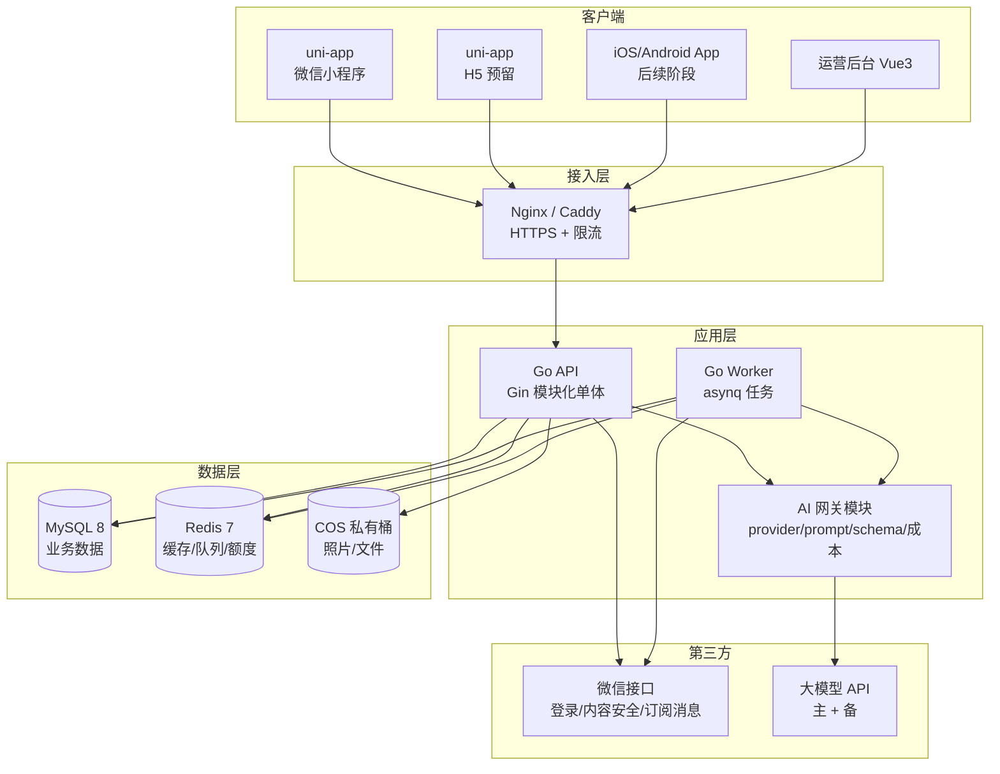
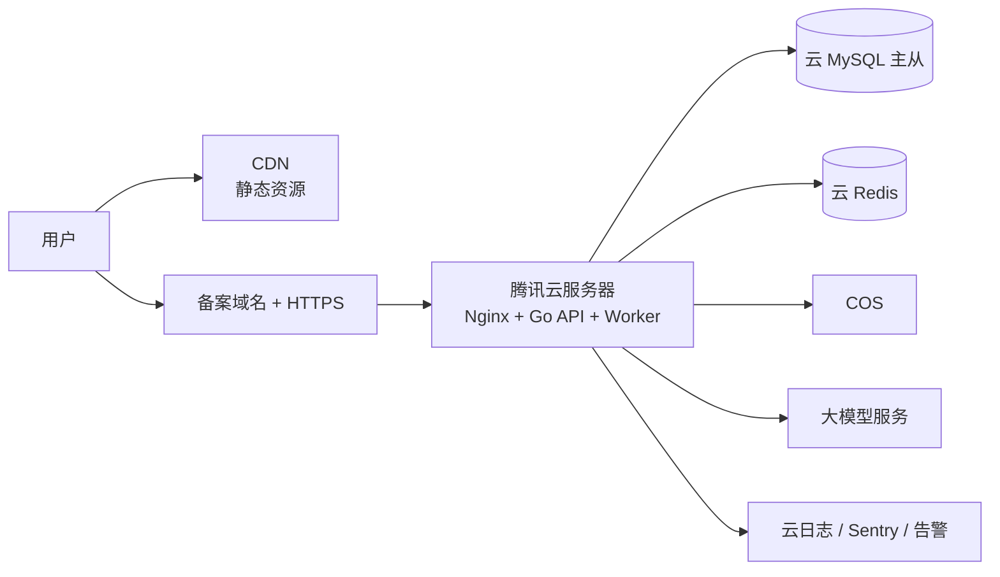
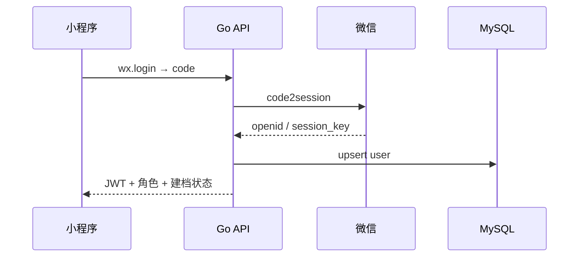
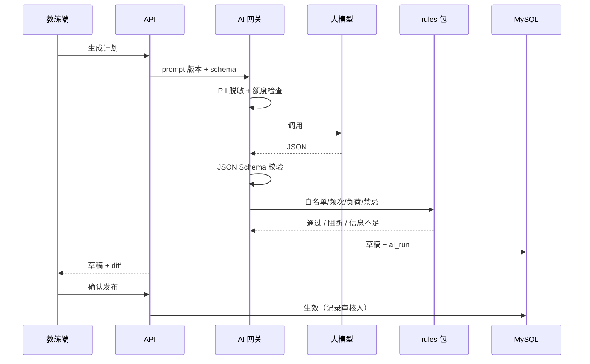
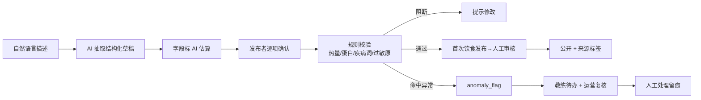

# Nerae 系统架构与技术选型

> 版本：v1.2 · 2026-10-23
> 状态：已按三项拍板更新（腾讯云 / Go / 跨端优先），前端 uni-app 已确认；当前仅契约/规划，无运行时实现
> 对应产品：[PRD v1.10](PRD.md)（A 方案：不收款、教练自主定价、训练+饮食计划广场、AI 分层、异常饮食识别）
> 说明：云产品与 AI 价格为量级估算，落地前按官网当前价格核对。

## 0. 本轮拍板记录

| # | 决策 | 结论 | 影响 |
|---|---|---|---|
| 1 | 云厂商 | **腾讯云**（已有服务器，先用现有一台） | 备案、CDN、短信、AI 供应商搭配 |
| 2 | 后端语言 | **Go** | 框架/ORM/队列/工程结构全部改为 Go 生态 |
| 3 | 前端策略 | **跨端优先 → uni-app（Vue3 + TS）**（已确认） | 小程序 / H5 / App 一套代码 |
| 4 | AI 模型 | **MiMo-V2.6 Flash（用户指定，价格优先）** | 官方型号已核验为 `mimo-v2.6-flash`；真实调用、条款和资质仍待验证 |

**待验证**：MiMo 实际账号限额、数据条款/健康场景质量与 App 打包。公示型号/价格依据及预算见成本文档，真实供应商测试是独立门槛。

## 1. 目标与约束

| 约束 | 内容 | 对架构的影响 |
|---|---|---|
| 端 | 微信小程序（学员/教练同端）+ 运营后台 Web；未来 iOS/Android App | 前端必须跨端分层，业务逻辑与 UI 解耦 |
| 交易 | A 阶段不收款、不分账 | 不需要订单、支付回调、对账、分账模块 |
| 免费层 | 计划广场未登录可浏览；训练 + 饮食；打卡 | 读多写少，需缓存与匿名访问 |
| AI | 教练副驾（必确认）、免费自助（只读/建议）、发布助手、异常识别 | 统一 AI 网关 + 规则引擎 + 审核队列 |
| 团队 | 1 产品 + 1 设计 + 2 全栈 + 1 AI + 1 运营 | 模块化单体；Go 模块化清晰 |
| 周期 | 8–12 周，分两批 | 先核心闭环，再计划广场 |
| 部署 | 中国大陆、ICP 备案、健康数据境内 | 境内云、加密、审计、可删除 |

**不引入**：Kubernetes、微服务、ES 集群、Kafka、自建模型。团队规模与周期不匹配。

## 2. 架构总览

### 2.1 逻辑架构



### 2.2 部署架构（MVP，复用现有腾讯云服务器）



- 先用现有 1 台腾讯云服务器起步：Nginx + Docker Compose（API、Worker、定时任务）
- 流量上来后把 Worker 拆到第二台；数据库尽早用云 MySQL（不要自建在应用机上）
- 图片走 COS 私有桶 + 签名 URL；分享图公开读 + CDN

## 3. 技术选型

### 3.1 跨端框架（本轮最关键决策）

需求：现在做微信小程序，未来做 iOS/Android App，改动尽量小。

| 方案 | 小程序 | iOS/Android | 代码复用 | 风险 | 结论 |
|---|---|---|---|---|---|
| **uni-app（Vue3 + TS）** | 编译 | 云打包/离线打包成原生 App | 高（表单/内容类页面约 70–85%） | DCloud 生态依赖；重交互页面需原生插件 | **推荐** |
| Taro 4（React + TS） | 编译 | RN 目标，成熟度一般 | 中（60–75%） | RN 目标维护与坑；调试链更长 | 备选 |
| 原生小程序 + RN | 原生 | RN | 低（UI 不共享，仅 API/逻辑） | 两套 UI 与状态层 | 不推荐（违背跨端优先） |
| Flutter | 不支持 | Flutter | 0（小程序需另做） | 小程序无法复用 | 不推荐 |
| 原生小程序 + Flutter | 原生 | Flutter | 低 | 两套技术栈 | 不推荐 |

**推荐 uni-app 的理由**

1. 一套代码同时出小程序、H5、App（DCloud 云打包），是「小程序 → App」路径最成熟的国内方案
2. Vue 3 + TypeScript + Vite，语法简单，团队上手快，与运营后台（Vue3 + Element Plus）同一套语言
3. 内容 + 表单 + 列表类产品对渲染性能要求不高，uni-app 足够；重页面可局部用原生插件
4. 生态组件齐：Wot Design Uni、uCharts 图表、uni-ui

**必须接受的代价（提前说清）**

- App 端不是 100% 复用：导航、权限、推送、商店合规、支付、深链都要单独做，预计 App 阶段追加 4–8 周
- 依赖 DCloud 打包链路；若未来要极致性能，重页面要换原生/RN，但届时业务层与 API 契约可保留
- 小程序端部分能力（Skyline、自定义组件性能）不如原生直接用，需按编译结果验收

**降低未来改动的架构约束（重要）**

1. **业务规则只放后端 Go**，前端只做即时提示，避免前后端两份规则漂移
2. 前端分三层：`api/`（请求与类型）、`domain/`（纯 TS 业务计算与格式化）、`ui/`（页面与组件）
3. 平台差异封装在 `platform/` 适配层（登录、存储、分享、推送、支付），页面不直接调用 `uni.*`
4. 组件库与设计 token 统一，App 阶段换壳不改业务
5. API 契约用 OpenAPI 生成 TS 类型，前后端同源

### 3.2 前端

| 层 | 选择 | 理由 | 备注 |
|---|---|---|---|
| 小程序/App/H5 | **uni-app + Vue 3 + TS + Vite** | 一套代码多端 | 已确认；兼容版本由 F01 实测锁定 |
| 组件库 | **Wot Design Uni** | Vue3 + TS、多端一致、维护活跃 | 备选 uview-plus |
| 图表 | **uCharts（qiun-data-charts）** | 多端适配、体积小 | 不用 echarts 全量包 |
| 状态 | **Pinia** | Vue3 官方推荐 | 不用 Vuex |
| 请求 | 自封装 `uni.request` + 拦截器 | 统一鉴权、错误、重试 | 类型由 OpenAPI 生成 |
| 运营后台 | **Vue 3 + Vite + Element Plus** | 与小程序同语言，降低切换成本 | 表格/表单密集，开发快 |

### 3.3 后端（Go）

| 层 | 选择 | 理由 | 备选与风险 |
|---|---|---|---|
| 语言 | **Go 1.23+** | 用户可读；部署简单；并发好 | — |
| Web 框架 | **Gin** | 生态最大、资料多、中间件成熟 | Echo/Fiber 亦可；Gin 团队最易接手 |
| ORM | **GORM** | 上手快、CRUD 省事 | 热点查询手写 SQL；禁用生产 auto-migrate |
| 迁移 | **golang-migrate** | 版本化、可回滚、CI 可校验 | 不用 GORM AutoMigrate |
| 缓存/队列 | **go-redis + asynq** | Redis 原生任务队列，Go 生态成熟 | 不引入 Kafka |
| 配置 | **viper** + 环境变量 | 多环境配置 | 密钥走 KMS/环境变量 |
| 日志 | **slog（标准库）** + JSON handler | 标准库、无重依赖 | 不用第三方重型日志框架 |
| 校验 | **go-playground/validator** | 请求参数校验 | 业务规则另写 rules 包 |
| API 文档 | **swag（OpenAPI 3）** | 生成 TS 类型给前端 | 契约先行 |
| 鉴权 | **golang-jwt** + 微信 code2session | 标准做法 | 后台加 TOTP（P1） |
| 结构化输出校验 | **santhosh-tekuri/jsonschema** | 校验 AI 输出 JSON | 失败重试/降级 |
| 监控 | **sentry-go + OpenTelemetry** | 错误与链路 | 云监控 + 企业微信告警 |
| 测试 | **testify + httptest** | 单测与接口测试 | 规则包必须覆盖 |

### 3.4 AI 与内容安全

| 层 | 选择 | 理由 | 备注 |
|---|---|---|---|
| 主模型 | **MiMo-V2.6 Flash（小米）** | 用户指定；价格实惠，适合高频调用 | `mimo-v2.6-flash` 与公示结构化输出已确认；运行质量、限流、数据条款和手续待核定 |
| 模型变更 | MVP 无自动备用模型 | 固定已选配置与预算 | 更换须单独评测、确认条款和批准配置 |
| 兜底 | 手工继续 + 明确失败 | 模型不可用/超限时不伪造输出 | 可主动选择现有模板，不能标为本次 AI 成功生成 |
| 调用 | 服务端调用，密钥不下发 | 安全与成本 | 前端绝不直连 |
| 输出约束 | JSON Schema + 规则引擎 | 训练/饮食强约束 | 不用自由文本解析 |
| 内容安全 | 微信 `msgSecCheck` / `mediaCheckAsync` + 自建词库 | 与平台口径一致 | 第三方审核补充 |
| 规则引擎 | Go `internal/rules`，表驱动 + 版本号 | 可解释、可审计、可单测 | 不用 Drools |

### 3.5 基础设施（腾讯云）

| 项 | 选择 | 说明 |
|---|---|---|
| 计算 | 现有腾讯云服务器 1 台起步（建议 2C4G 以上） | Docker Compose：nginx/api/worker |
| 扩容 | 第二台拆 Worker；后续按 QPS 加 | 不直接上 K8s |
| 数据库 | 云 MySQL 8（主从/基础版） | 应用机不自建 DB |
| 缓存 | 云 Redis 7 | 1–2G 起步 |
| 对象存储 | COS 私有桶 + CDN | 图片/分享图 |
| 域名/备案 | 腾讯云备案 | 小程序服务器域名需 HTTPS 且已备案 |
| CI/CD | GitHub Actions 或 CODING → TCR 镜像 → 服务器 pull | 先手动审批，稳定后自动 |
| 监控 | 云监控 + Sentry + 企微告警 | 不自建 Prometheus 集群 |
| 密钥 | 腾讯云 KMS + 环境变量 | 不入库、不入代码 |

## 4. 后端工程结构（Go）

```
cmd/
  api/main.go            # HTTP 服务入口
  worker/main.go         # asynq worker 入口
internal/
  config/                # viper 配置
  server/                # gin 路由、中间件、错误处理
  middleware/            # 鉴权、限流、request_id、审计
  modules/
    auth/                # 微信登录、JWT、角色
    user/                # 用户、学员档案、18+ 校验
    coach/               # 教练认证、主页、服务包、定价
    plazacoach/          # 教练广场
    plazaplan/           # 计划广场：训练/饮食、来源标签、热门
    plan/                # 个人计划：另存、新建、版本
    diet/                # 饮食计划、打卡、依从率
    publish/             # 发布助手
    relation/            # 服务关系、数据授权
    appointment/         # 咨询单、成交自报
    delivery/            # 计划发布、点评、周报
    review/              # 评价与申诉
    moderation/          # 审核、举报、抽检
    anomaly/             # 异常识别
    ai/                  # AI 网关、prompt 注册表、成本
    notify/              # 订阅消息、站内、客服消息
    admin/               # 后台接口与审计
    analytics/           # 埋点接收与聚合
  rules/                 # 训练/饮食规则（纯函数 + 表驱动 + 版本）
  platform/wx/           # 微信 SDK 封装
  store/                 # MySQL/Redis 访问层
pkg/
  secure/                # 加密、脱敏
  jsonschema/            # AI 输出校验封装
migrations/              # golang-migrate SQL
api/openapi.yaml         # 契约唯一真源；生成物不反向覆盖
```

**原则**

- 模块之间通过 service 接口调用，不跨模块直接写表
- 规则包 `internal/rules` 不依赖框架，纯函数，必须有单测与用例集
- 热点查询手写 SQL，GORM 只用于常规 CRUD
- 所有后台操作写审计表

## 5. 前端工程结构（uni-app）

```
src/
  pages/                 # 页面（学员/教练共用，按角色分流）
  components/            # 通用组件
  api/                   # 请求封装 + OpenAPI 生成类型
  domain/                # 纯 TS：计算、格式化、校验提示
  platform/              # 平台适配：登录/存储/分享/推送/支付
  stores/                # Pinia
  styles/                # 设计 token、主题
  static/
```

**约束**：页面不直接调用 `uni.*`，统一走 `platform/`；业务计算放 `domain/`，不写进页面。

## 6. 关键流程

### 6.1 微信登录



### 6.2 AI 计划生成（教练副驾）



### 6.3 发布助手与异常识别



### 6.4 内容安全

- 文本：微信 `msgSecCheck` → 自建词库 → 规则引擎 → 通过/拦截
- 图片：`mediaCheckAsync` 异步回调 → 未通过下架并通知
- 人工：首次饮食发布 100%；抽检 10–20%；举报 24h 内先下架
- 全部动作写 `moderation_task` 与审计日志

## 7. 数据层

### 7.1 MySQL 主要表群

| 域 | 表 |
|---|---|
| 用户 | user、student_profile、coach_profile、data_grant |
| 关系 | service_relation、appointment、invite |
| 计划 | plan_template、diet_plan_template、plan、plan_day、prescription、food_library |
| 记录 | workout_session、set_record、body_metric、diet_checkin、check_in |
| 互动 | review、notification、report |
| AI/审核 | ai_run、anomaly_flag、prompt_version、moderation_task、audit_log |

### 7.2 索引与缓存

- 广场列表：`(plan_type, status, goal, difficulty)` 复合索引；热门榜 Redis ZSET，定时重算
- 教练广场：`(status, city, service_mode)` + 评分/响应冗余字段
- 打卡：`(user_id, plan_id, date)` 唯一键
- Redis：热门榜、限流、AI 额度、asynq 队列、临时状态
- 备份：每日全量 + binlog，保留 7–30 天；每季度恢复演练

## 8. AI 工程

**AI 网关职责**：固定供应商适配与显式配置版本、prompt 注册表（版本化）、JSON Schema 校验、PII 脱敏、成本计量、额度与熔断、安全前置、输出标识。

主模型固定 `mimo-v2.6-flash`。失败最多一次受预算限制的同配置重试；信息不足/安全阻断不做技术重试，不自动升 Pro 或切供应商。配置变更必须先做条款、质量、成本回归和审批。

| 场景 | 模型档位 |
|---|---|
| 训练计划生成/调整 | mimo-v2.6-flash（固定） |
| 饮食结构化抽取 | MiMo-V2.6 Flash |
| 点评/话术/周报 | mimo-v2.6-flash（固定） |
| 计划解读/记录分析 | mimo-v2.6-flash（固定） |
| 异常识别 | 规则优先 + 同配置辅助（只标记） |

**关于自托管**：MiMo 是开源模型，理论上可自建推理，但 MVP 不自建——GPU 成本与运维不划算，先用官方 API；后期调用量上来再评估。

**评测**：结构合法性、安全阻断、饮食过敏原、字段完整性用例集；上线前回归，线上抽检 1–5%。
**成本**：缓存 + 分层额度 + 熔断；公式 `调用数 × (输入 token × 单价 + 输出 token × 单价) + 重试 + 审核 + 存储`。

## 9. 安全与合规

| 级别 | 数据 | 控制 |
|---|---|---|
| L1 公开 | 计划广场、教练主页 | 发布走审核 |
| L2 个人 | 手机号、训练记录 | 登录 + 本人/授权关系 |
| L3 敏感健康 | 伤病、身体数据、照片、打卡 | 单独同意、加密、关系授权、审计 |

- 权限：RBAC + ABAC（`service_relation` + `data_grant` 是否有效、范围覆盖）
- 加密：TLS；手机号/身份证/伤病字段应用层 AES-GCM，密钥在 KMS；COS 私有桶签名 URL
- 审计：登录、授权/撤回、教练访问敏感数据、导出、后台操作、审核动作
- 删除：注销异步删除/匿名化；法定留存隔离限权；健康正文不进通用日志

## 10. 可观测性与发布

| 项 | 方案 |
|---|---|
| 日志 | JSON、request_id、脱敏；云日志 |
| 指标 | QPS、P95、错误率、AI 成功率/成本、审核积压 |
| 告警 | 企微机器人：5xx、AI 失败率、队列积压、成本超阈值 |
| 发布 | 小程序体验版/审核版 + 后台灰度开关；DB 迁移向前兼容 |
| 回滚 | 镜像保留 3 版；迁移用补偿脚本 |

## 11. 成本与容量

统一使用 [成本与上线条件](小程序上线成本与资质.md) 的三个假设场景；旧每月 650–3,700 元表缺规格与流量依据，撤出执行口径。首次启用月份、人力、审核、法律咨询与未知外部费用必须独立列出；按真实用量和供应商报价更新，不把压力情景当实际账单。

## 12. 跨端演进路线（关键）

| 阶段 | 时间 | 做的事 | 为 App 留下的东西 |
|---|---|---|---|
| Phase 0 | 当前规划，待 F01/F02 实施 | uni-app 小程序 + Vue3 后台 + Go API | 建立 OpenAPI 契约、domain 层、platform 适配层 |
| Phase 1 | 小程序闭环通过后按证据排期 | 小程序迭代、H5 验证 | 复用页面的实际可编译性与体验需验证 |
| Phase 2 | 需要 App 时 | uni-app 云打包出 iOS/Android | 复用率由 P02 实测，不预设百分比 |
| Phase 3 | 实测 App 体验不足时 | 评估局部原生插件或页面替换 | 尽量隔离端能力；业务/契约影响须单独评审 |

**App 阶段必须单独做的**：推送（厂商通道）、登录（开放平台/Apple）、支付（若卖订阅，iOS 可能要求 IAP）、商店合规（软著、备案、隐私清单）、深链、强制更新。这部分是真实工作量，不是「一套代码自动搞定」。

## 13. 待确认

| # | 决策 | 结论 | 待办 |
|---|---|---|---|
| 1 | 跨端框架 | **uni-app（Vue3 + TS）** 已确认 | 搭建工程与多端验收清单 |
| 2 | AI 主模型 | **MiMo-V2.6 Flash**（已指定） | 验证实际账号、计费、限流、结构化调用与数据条款；公示信息见成本文档 |
| 3 | AI 失败策略 | 同配置受限重试/手工继续 | 无自动备用供应商；改配置单独评测审批 |
| 4 | App 打包方式 | DCloud 云打包起步 | 后期可转离线打包 |

**AI 供应商尽调清单（接入前逐项确认）**

1. 生成式 AI 服务备案/登记状态（面向公众提供服务）
2. 是否支持 JSON 模式/结构化输出、函数调用
3. 上下文长度、并发与限流、SLA
4. 数据条款：是否用于训练、存储地域、日志保留
5. 计价单位（输入/输出 token）与免费额度
6. 企业实名与开票要求

## 14. 与 PRD 里程碑对应

| PRD 阶段 | 架构交付 |
|---|---|
| 0 决策与备案 | 域名/备案、服务器环境、CI 骨架、OpenAPI 初始化 |
| 1 设计 | 数据模型评审、API 契约、AI prompt 初版、rules 用例 |
| 2 核心闭环 | auth/user/coach/relation/appointment/delivery + AI 网关 |
| 3 计划广场 | plazaplan/publish/diet/anomaly/moderation + 热门缓存 |
| 4 提审 | 隐私政策、SDK 清单、内容安全联调、日志脱敏检查 |
| 5 Pilot | 指标看板、告警、成本监控、抽检流程 |

> 本表是架构阶段映射，不是人员排期。环境与多端适配实际耗时由 F01/F02 实测后更新任务估工，不沿用固定“一周”承诺。


## 15. 开发中的模块边界

上文目录是概念结构；实际 monorepo 落位统一见 IMPLEMENTATION_PLAN §3：`apps/api`、`apps/client`、`apps/admin`、`packages/contracts`、`packages/ui`。不同时维护第二份 OpenAPI。

新增 `catalog`（动作与版本）、`schedule`（安排/事项/选择 CAS）、`conversation`（关系/咨询线程与已读）、`workout`（会话与组）领域模块，AI 建议落在 plan 内，由 ai 网关只提供候选结果。所有权清单在任务 DAG；共享 server wiring、DDL 合并、schema、依赖锁文件由集成 owner 串行处理。

- HTTP handler 只解码、鉴权上下文、调用应用服务和映射错误；不能直接调用模型或跨模块 GORM 查询。
- 应用服务组织事务；领域层负责纯状态与日期规则；repository 隔离持久化；跨模块经窄接口或 outbox 事件。避免一个全局 BaseService 持有所有表。
- 关系/授权/内容发布的一致性使用 MySQL 事务。Redis 只作可重建缓存/额度预留，不能成为最终授权真源。授权失效同时写 outbox，敏感读在缓存命中后仍核对授权版本。
- worker 至少一次投递；以业务事件 ID 去重、限次重试和死信处理。任务启动时持有的旧 grant 不足以授权模型调用/发送，提交前再次核查。
- 每个模块迁移独立编号目录，集成时全局排序。迁移采用 expand/contract、旧新应用兼容、备份恢复演练，禁止生产自动 GORM AutoMigrate。
- 客户端只用生成的 transport types；视图模型转换在 feature 层。用户/关系/版本共同作为缓存键，切账号清除私有队列和缓存；平台能力封装在 platform，不在页面散落微信调用。
- 前端 domain 不重复服务端授权判断；离线只能创建待同步操作，不宣布服务端完成。错误 code 到中文文案映射集中维护，requestId 放可复制的详情。

边界验收、依赖锁定、CI、备份/恢复、供应商测试与安全负向矩阵见 VALIDATION_PLAN。概念图与文档都不证明这些实现已经存在。
